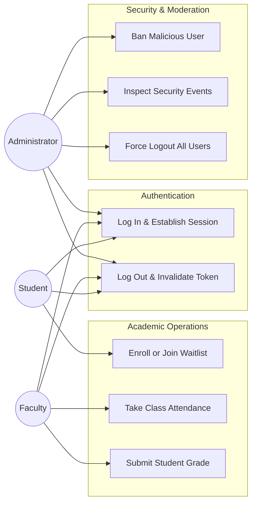
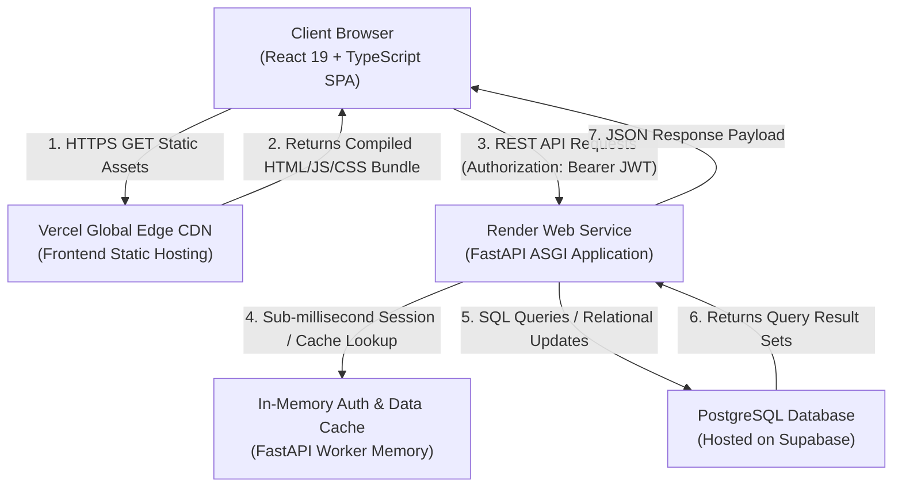
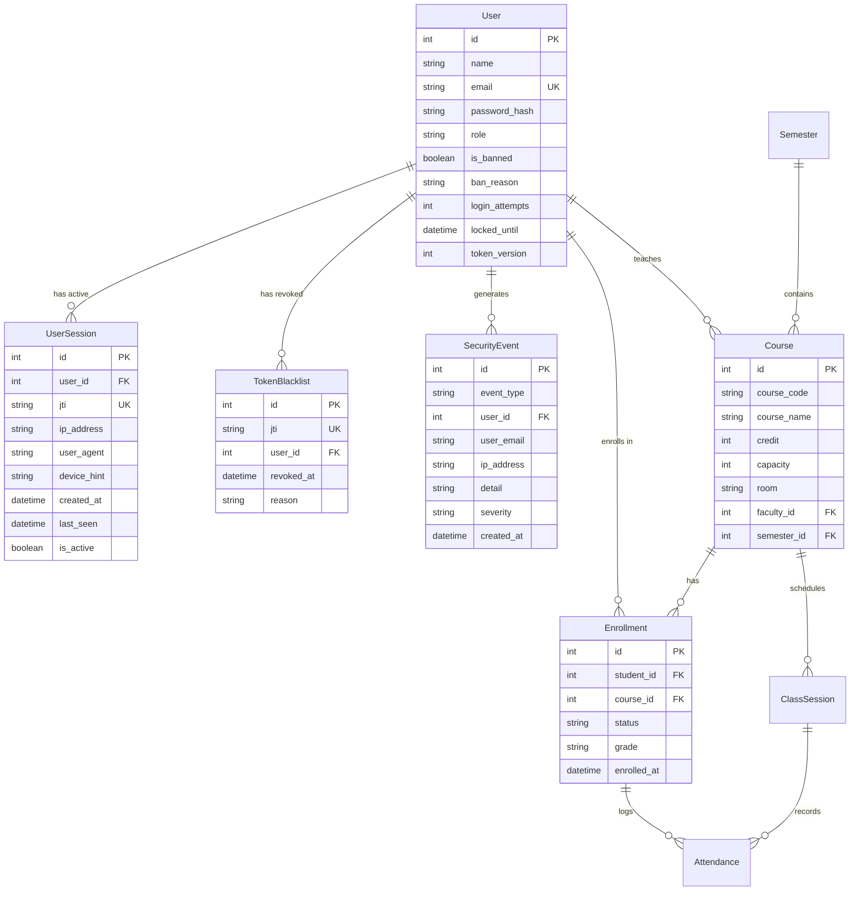
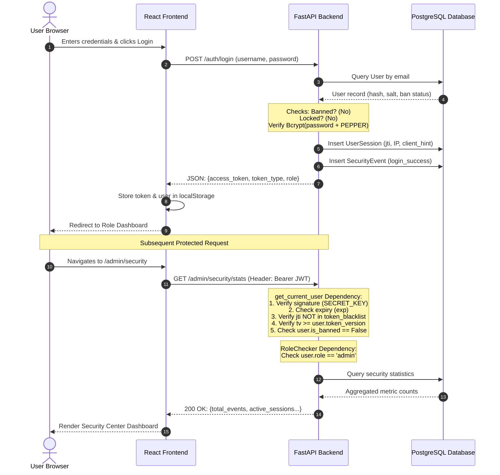
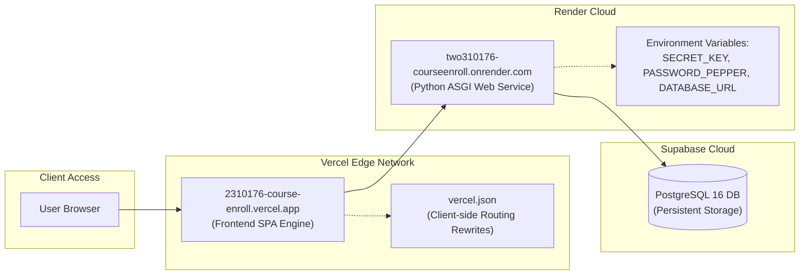

# Independent University, Bangladesh
## Department of Computer Science & Engineering
### CSE309: Web Application & Internet — Autumn 2026

---

# FINAL PROJECT SUBMISSION REPORT

**Project Title:** CourseEnroll — Secure Multi-User University Course Registration & Academic Administration Platform  
**Live Application (Vercel):** [https://2310176-course-enroll.vercel.app](https://2310176-course-enroll.vercel.app)  
**Backend API (Render):** [https://two310176-courseenroll.onrender.com](https://two310176-courseenroll.onrender.com)  
**Interactive API Documentation (Swagger):** [https://two310176-courseenroll.onrender.com/docs](https://two310176-courseenroll.onrender.com/docs)  
**GitHub Repository:** [https://github.com/raihanurakter02/2310176-CourseEnroll](https://github.com/raihanurakter02/2310176-CourseEnroll)  

---

### Submitted By:
* **Student Name:** Raihanur Akter  
* **Student ID:** 2310176  
* **Section:** 06 
* **Team Number:** Individual (Team 2310176)  
* **Submission Date:** 28 November 2026  

### Submitted To:
* **Instructor:** Sayef Reyadh  
* **Designation:** Adjunct Lecturer  
* **Department:** Computer Science & Engineering  
* **Institution:** Independent University, Bangladesh (IUB)  

---

## Table of Contents

- [1. Executive Summary](#1-executive-summary)
  - [1.1 Project Overview](#11-project-overview)
  - [1.2 What Was Built Since the Mid Assessment](#12-what-was-built-since-the-mid-assessment)
  - [1.3 Live Links](#13-live-links)
- [Part A. Product Requirements (PRD)](#part-a-product-requirements-prd)
  - [A1. Problem Statement](#a1-problem-statement)
  - [A2. Users and Roles](#a2-users-and-roles)
  - [A3. Goals and Success Measures](#a3-goals-and-success-measures)
  - [A4. Scope and Non-Goals](#a4-scope-and-non-goals)
  - [A5. User Stories](#a5-user-stories)
- [Part B. Software Requirements (SRS)](#part-b-software-requirements-srs)
  - [B1. Introduction & Definitions](#b1-introduction--definitions)
  - [B2. Functional Requirements](#b2-functional-requirements)
  - [B3. Non-Functional Requirements](#b3-non-functional-requirements)
  - [B4. Roles and Permission Matrix](#b4-roles-and-permission-matrix)
  - [B5. Use Cases](#b5-use-cases)
  - [B6. Acceptance Criteria](#b6-acceptance-criteria)
  - [B7. Traceability Matrix](#b7-traceability-matrix)
- [Part C. Technical Design (TDD)](#part-c-technical-design-tdd)
  - [C1. Technology Stack](#c1-technology-stack)
  - [C2. System Architecture](#c2-system-architecture)
  - [C3. Backend and Frontend Structure](#c3-backend-and-frontend-structure)
  - [C4. Data Model (ER Diagram & Schemas)](#c4-data-model)
  - [C5. API Design](#c5-api-design)
  - [C6. JWT Authentication Design](#c6-jwt-authentication-design)
  - [C7. RBAC Design](#c7-rbac-design)
  - [C8. Admin Dashboard Design](#c8-admin-dashboard-design)
  - [C9. Security Design and Threats](#c9-security-design-and-threats)
  - [C10. Deployment on Vercel & Render](#c10-deployment-on-vercel--render)
  - [C11. Automated Testing](#c11-automated-testing)
- [Part D. Evidence: Screenshots of Running Application](#part-d-evidence-screenshots-of-running-application)
- [Part E. Project Management and Conclusion](#part-e-project-management-and-conclusion)
  - [E1. How to Run and Test](#e1-how-to-run-and-test)
  - [E2. GitHub Work (Issues & Pull Requests)](#e2-github-work)
  - [E3. Limitations](#e3-limitations)
  - [E4. Future Work](#e4-future-work)
  - [E5. Sources, Libraries and Tools](#e5-sources-libraries-and-tools)
- [Appendix. Test Accounts and Video Demo](#appendix-test-accounts-and-video-demo)

---

## List of Figures & Tables

* **Figure 1:** System Architecture and Data Flow
* **Figure 2:** Use Case Diagram
* **Figure 3:** Entity-Relationship (ER) Diagram
* **Figure 4:** JWT Authentication & Session Lifecycle (Sequence Diagram)
* **Figure 5:** Request Authorization & Reusable RBAC Flow
* **Figure 6:** Cloud Deployment Architecture
* **Table 1:** System URLs and Live Deployments
* **Table 2:** User Personas and Role Boundaries
* **Table 3:** Core Goals and Measurable Success Criteria
* **Table 4:** Product User Stories
* **Table 5:** Functional Requirements — Authentication (`FR-AUTH`)
* **Table 6:** Functional Requirements — Role-Based Access Control (`FR-RBAC`)
* **Table 7:** Functional Requirements — Administration & Moderation (`FR-ADM`)
* **Table 8:** Functional Requirements — Academic Resource Domain (`FR-DOMAIN`)
* **Table 9:** Non-Functional Requirements
* **Table 10:** Endpoint Authorization Matrix by Role
* **Table 11:** Course Section & Shared Resource Permission Matrix
* **Table 12:** System Invariant Safety Rules
* **Table 13:** Detailed Use Case Specifications
* **Table 14:** Gherkin Acceptance Criteria
* **Table 15:** Comprehensive Traceability Matrix
* **Table 16:** Production Technology Stack
* **Table 17:** Database Schema Definitions
* **Table 18:** REST API Endpoints Specification
* **Table 19:** JWT Payload Claims Schema
* **Table 20:** Admin Portal Management Views
* **Table 21:** STRIDE Threat Analysis and Security Defenses
* **Table 22:** Production Environment Variables
* **Table 23:** Automated Pytest Test Results
* **Table 24:** GitHub Milestone Issues and Pull Requests
* **Table 25:** External Dependencies, Libraries, and Tools

---

# 1. Executive Summary

### 1.1 Project Overview
**CourseEnroll** is a production-ready, cloud-deployed university course registration and academic Enterprise Resource Planning (ERP) platform. Designed for modern higher education workflows, the system bridges students, faculty, and university administrators into a cohesive, secure environment. Students can explore interactive course catalogs, register for sections with real-time seat availability, enter automated FIFO waitlists when sections fill to capacity, inspect weekly timetable matrices, and track semester attendance records. Faculty members can oversee enrolled student rosters, schedule class sessions, record daily attendance with percentage indicators, and evaluate final grades within university-defined grading windows. Administrators manage the overarching institution via an integrated Admin Control Center featuring user management, course section assignments, enrollment approvals, broadcast announcements, academic timeline controls, and an Enterprise Security Center with active session tracking, token blacklisting, and security event audit logs.

**Architecture Stack:** Single Page Application (SPA) built with **React 19 with TypeScript** and Vite deployed on **Vercel**, communicating via RESTful APIs with a high-performance **FastAPI (Python 3.14)** backend deployed on **Render**, backed by a cloud-hosted **PostgreSQL (Supabase)** relational database.

### 1.2 What Was Built Since the Mid Assessment
Since the mid-term project evaluation, the application was systematically expanded from a single-user prototype into a hardened multi-user enterprise platform:
1. **JWT Authentication with Session Control:** Implemented stateless yet revocable JSON Web Tokens (HS256) with unique JWT IDs (`jti`), server-side password hashing using **Bcrypt** and an environment-isolated **Server Pepper**, automatic 5-attempt brute-force lockout, and active device tracking.
2. **Role-Based Access Control (RBAC):** Built a centralized, reusable server-side authorization dependency (`RoleChecker`) enforcing strict role privileges (`student`, `faculty`, `admin`), object-level ownership checks (students cannot inspect or drop other students' enrollments), and administrative safety invariants.
3. **Admin Security Center & Audit Logging:** Engineered an enterprise security console featuring real-time active session monitoring with remote session revocation, an emergency system-wide killswitch (*Force Logout All Users* via token versioning), live security audit logging (`security_events`), and ban/unban moderation with mandatory reason tracking.
4. **Academic Domain Enhancements:** Implemented automated FIFO waitlist promotion upon seat drop, faculty session attendance tracking with cumulative rate analytics, CSV report generation, university announcement broadcasting with unread status tracking, and academic semester timeline controls.
5. **High-Performance Caching & UI Polish:** Integrated an in-memory auth session cache on the backend (eliminating repetitive database queries) and a Stale-While-Revalidate (SWR) multi-tier caching engine on the frontend, accompanied by an enterprise-grade search and filter toolbar design system across all management tables.

### 1.3 Live Links

#### Table 1: System URLs and Live Deployments
| Resource | URL | Description |
| :--- | :--- | :--- |
| **Frontend Application (Vercel)** | [https://2310176-course-enroll.vercel.app](https://2310176-course-enroll.vercel.app) | Live production React frontend deployed on Vercel edge network. |
| **Backend REST API (Render)** | [https://two310176-courseenroll.onrender.com](https://two310176-courseenroll.onrender.com) | FastAPI cloud backend service. |
| **Interactive API Documentation** | [https://two310176-courseenroll.onrender.com/docs](https://two310176-courseenroll.onrender.com/docs) | Live Swagger UI OpenAPI testing suite. |
| **Alternative OpenAPI Schema** | [https://two310176-courseenroll.onrender.com/redoc](https://two310176-courseenroll.onrender.com/redoc) | ReDoc structured API reference. |
| **GitHub Repository** | [https://github.com/raihanurakter02/2310176-CourseEnroll](https://github.com/raihanurakter02/2310176-CourseEnroll) | Full open-source codebase with test suites and documentation. |
| **Video Demonstration** | *Provided in PDF Appendix* | 5-to-8 minute complete end-to-end walkthrough of all roles. |

*(Note: In accordance with security guidelines, evaluator demo account credentials are excluded from the public repository and documented exclusively in the PDF Appendix).*

---

# Part A. Product Requirements (PRD)

### A1. Problem Statement
Traditional university course enrollment systems often suffer from critical operational and security deficiencies. Students frequently experience chaotic registration windows plagued by unhandled seat over-subscriptions, a lack of transparency regarding waitlist positioning, and an inability to visualize schedule collisions in real time. Faculty instructors are forced to manage student attendance and submit course grades across disconnected spreadsheets, increasing the risk of data desynchronization and unmonitored grade alterations outside approved academic windows. 

From an institutional security standpoint, legacy university portals often store credentials with weak hashing mechanisms, lack centralized Role-Based Access Control, and provide zero administrative visibility into concurrent user logins, active devices, or credential-stuffing attacks. If an account is compromised or a student leaves the university, administrators have no mechanism to invalidate active access tokens or trace malicious activities. CourseEnroll resolves these institutional pain points by providing an integrated, secure, and audited course enrollment platform.

### A2. Users and Roles

#### Table 2: User Personas and Role Boundaries
| Role | Persona & Description | Primary Tasks & Capabilities | Strict System Boundaries (Must Never Do) |
| :--- | :--- | :--- | :--- |
| **Visitor** | Unauthenticated user accessing the domain. | View landing page, navigate to login/registration forms, inspect public documentation. | Cannot view course rosters, student schedules, admin controls, or trigger mutations. |
| **Student** | Registered learner enrolled in university degree programs. | Browse course catalog, filter by seat availability, submit enrollment requests, join waitlists, drop classes, view personal weekly timetable matrix, review attendance stats, read announcements. | Must never access admin consoles, approve registrations, modify course limits, view other students' records, enter grades, or ban users. |
| **Faculty** | Academic instructor assigned to teach specific course sections. | Inspect assigned class sections, view enrolled student rosters, schedule lectures, take roll call (Present/Late/Absent), export CSV attendance reports, submit final grades during open grading periods. | Must never modify university course capacities, delete courses, alter system user roles, access security logs, or alter classes taught by other faculty. |
| **Admin** | University registrar, department chair, or IT security officer. | Manage user accounts, ban/unban violators with logged reasons, assign faculty to courses, approve/reject pending registrations, broadcast campus notices, define semester timelines, inspect active device sessions, execute emergency force logouts, inspect security audit logs. | Must never change their own role away from admin, ban another administrator account, or delete their own active admin account. |

### A3. Goals and Success Measures

#### Table 3: Core Goals and Measurable Success Criteria
| Goal ID | Strategic Goal | Measurable Success Metric |
| :--- | :--- | :--- |
| **G-01** | **Strict Identity & Password Security** | Passwords hashed using Bcrypt + Environment Pepper with 0 plain-text storage; 5 consecutive failed logins trigger 30-minute lockout. |
| **G-02** | **Cryptographic Session Control** | Every JWT access token verified on every protected request with `jti` session blacklisting; token revocation takes effect on the next request ($< 1$ second). |
| **G-03** | **Zero Cross-User Data Leakage** | 100% of user data endpoints enforce ownership filtering in database queries; accessing foreign records returns `403 Forbidden` or `404 Not Found`. |
| **G-04** | **Safety Invariant Enforcement** | 100% rejection rate when an admin attempts to ban another admin or demote their own account. |
| **G-05** | **Automated Capacity & Waitlist Integrity** | Immediate FIFO promotion of the top waitlisted student when an enrolled student drops an at-capacity course section. |
| **G-06** | **High-Throughput Responsiveness** | In-memory authentication and query caching ensures sub-50ms endpoint response times under regular operation. |

### A4. Scope and Non-Goals
* **In Scope:**
  * JWT-based authentication with bcrypt password hashing and environment-variable pepper.
  * Reusable, server-enforced Role-Based Access Control (RBAC) across Students, Faculty, and Administrators.
  * Ownership-based data isolation across enrollments, grading, and course management.
  * Enterprise Security Center: User session tracking, remote session revocation, force-logout killswitch, and audit logging.
  * Academic resource features: Course catalog, prerequisite/credit tracking, dynamic weekly timetable grid, attendance taking, grade assignment with semester deadline validation, and broadcast announcements.
  * Production deployment on Vercel (Frontend) and Render/PostgreSQL (Backend).
* **Out of Scope (Non-Goals):**
  * Financial tuition payment processing or credit card gateways (deferred to external bursar billing APIs).
  * Direct SMS messaging gateways (system relies on internal inbox and real-time websockets).
  * Mobile native binary applications (solved via responsive, mobile-first Web SPA architecture).
* **Assumptions and Constraints:**
  * Modern web browser support (Chrome, Firefox, Safari, Edge) with JavaScript and LocalStorage enabled.
  * Hosting constraints of free-tier cloud environments (Render spin-down mitigated by in-memory caching and keep-alive pings).

### A5. User Stories

#### Table 4: Product User Stories
| Story ID | Persona | Action Requirement | Business Value & Justification |
| :--- | :--- | :--- | :--- |
| **US-01** | Visitor | Sign up with email, password, full name, and role | Create a secure academic account to access university services. |
| **US-02** | User | Log in with registered credentials and receive a signed JWT | Establish an authenticated, encrypted session without exposing passwords. |
| **US-03** | User | Log out cleanly, invalidating active device tokens | Ensure public/shared library computers cannot be accessed by subsequent users. |
| **US-04** | Student | Browse catalog and filter courses by keyword and credits | Rapidly discover required degree courses with transparent seat metrics. |
| **US-05** | Student | Join waitlist when a course section has reached capacity | Reserve an automated priority spot in line without manual administrator intervention. |
| **US-06** | Student | View personalized weekly schedule matrix and print verification slip | Prevent timetable overlaps and obtain official semester registration proof. |
| **US-07** | Faculty | Inspect assigned class sections and view enrolled student roster | Prepare syllabus materials and identify officially enrolled attendees. |
| **US-08** | Faculty | Take daily attendance and view cumulative attendance rates | Maintain institutional academic integrity and monitor student retention. |
| **US-09** | Faculty | Submit official student letter grades during open grading periods | Record academic marks securely while respecting registrar deadlines. |
| **US-10** | Admin | Review pending enrollment requests and approve or reject them | Enforce departmental prerequisites and official seat allocation controls. |
| **US-11** | Admin | Search users, filter by role/status, and ban violators with a reason | Maintain campus safety and prevent abusive or compromised accounts from acting. |
| **US-12** | Admin | View real-time security events and revoke suspect device sessions | Detect token tampering, credential brute-forcing, and isolate stolen devices. |

---

# Part B. Software Requirements (SRS)

### B1. Introduction & Definitions
This Software Requirements Specification (SRS) establishes the complete functional and non-functional requirements for the CourseEnroll platform. It serves as the formal technical contract for system behavior, access limits, and security validation.

#### Terminology & Standards
* **JWT (JSON Web Token - RFC 7519):** An open standard defining a compact, URL-safe container for cryptographically signed claims.
* **Access Token:** A short-lived, cryptographically signed Bearer token granting access to authorized API endpoints.
* **JTI (JWT ID):** A unique UUID4 identifier embedded in every issued token used for precise session tracking and revocation.
* **RBAC (Role-Based Access Control):** An authorization mechanism where system access rights are granted based on assigned roles rather than individual user identities.
* **Pepper:** A server-side secret constant stored outside the database, appended to passwords before hashing to protect against database leak compromises.
* **Audit Log:** An append-only chronological record of security-relevant system operations providing verifiable evidence of activities.

### B2. Functional Requirements

#### Table 5: Functional Requirements — Authentication (`FR-AUTH`)
| Requirement ID | Requirement Description | Enforcing Component |
| :--- | :--- | :--- |
| **FR-AUTH-01** | The system shall register users with name, email, password, and role, ensuring email uniqueness. | `POST /auth/register` |
| **FR-AUTH-02** | The system shall hash passwords using Bcrypt combined with an environment secret Pepper. | `backend/auth.py` |
| **FR-AUTH-03** | The system shall authenticate valid credentials and issue a signed HS256 JWT access token. | `POST /auth/login` |
| **FR-AUTH-04** | The access token payload shall embed `sub` (email), `id`, `role`, `name`, `tv`, `jti`, and `exp`. | `backend/auth.py` |
| **FR-AUTH-05** | The system shall restrict access token lifetime to 60 minutes or less. | `backend/auth.py` |
| **FR-AUTH-06** | The system shall track failed logins and lock an account for 30 minutes upon 5 consecutive failures. | `models.User.locked_until` |
| **FR-AUTH-07** | The system shall register active device sessions into `user_sessions` with IP and client hints. | `models.UserSession` |
| **FR-AUTH-08** | The system shall revoke active session tokens upon logout by writing their `jti` to `token_blacklist`. | `POST /auth/logout` |
| **FR-AUTH-09** | The system shall reject missing, expired, tampered, or blacklisted tokens with `HTTP 401`. | `backend/main.py:get_current_user` |
| **FR-AUTH-10** | The system shall support global session revocation by incrementing user `token_version`. | `POST /admin/security/force-logout-all` |

#### Table 6: Functional Requirements — Role-Based Access Control (`FR-RBAC`)
| Requirement ID | Requirement Description | Enforcing Component |
| :--- | :--- | :--- |
| **FR-RBAC-01** | The system shall enforce role checks on every protected endpoint via a centralized dependency. | `RoleChecker` |
| **FR-RBAC-02** | The system shall reject requests with insufficient role privileges with `HTTP 403 Forbidden`. | `backend/main.py:589` |
| **FR-RBAC-03** | The system shall restrict course enrollment deletion to the owning student or an administrator. | `DELETE /enrollments/{id}` |
| **FR-RBAC-04** | The system shall restrict grading and attendance taking to the assigned faculty of that section. | `PUT /enrollments/{id}/grade` |
| **FR-RBAC-05** | The system shall reject any administrative attempt to ban an administrator account (`HTTP 400`). | `POST /admin/security/users/{id}/ban` |
| **FR-RBAC-06** | The system shall reject any administrative attempt to demote their own account role (`HTTP 400`). | `PUT /users/{id}` |
| **FR-RBAC-07** | The system shall immediately block banned users on their next request regardless of token expiry. | `get_current_user` |
| **FR-RBAC-08** | The system shall enforce frontend route guards matching backend RBAC rules. | `ProtectedRoute.tsx` |

#### Table 7: Functional Requirements — Administration & Moderation (`FR-ADM`)
| Requirement ID | Requirement Description | Enforcing Component |
| :--- | :--- | :--- |
| **FR-ADM-01** | The system shall provide aggregate statistics (users, banned accounts, active sessions, events). | `GET /admin/security/stats` |
| **FR-ADM-02** | The system shall provide searchable, filterable user management with role and status toggles. | `GET /users` & `AdminUsers.tsx` |
| **FR-ADM-03** | The system shall allow admins to ban users with a mandatory reason, revoking all active sessions. | `POST /admin/security/users/{id}/ban` |
| **FR-ADM-04** | The system shall allow admins to unban suspended users, restoring standard access. | `POST /admin/security/users/{id}/unban` |
| **FR-ADM-05** | The system shall provide an audit log view filterable by severity, IP, event type, and user. | `GET /admin/security/events` |
| **FR-ADM-06** | The system shall display active concurrent sessions with IP, browser hint, and last-seen metrics. | `GET /admin/security/sessions` |
| **FR-ADM-07** | The system shall allow admins to terminate any specific session remotely. | `DELETE /admin/security/sessions/{id}` |
| **FR-ADM-08** | The system shall allow admins to assign faculty members to specific course sections. | `PUT /courses/{id}/faculty` |
| **FR-ADM-09** | The system shall provide a pending enrollment approvals queue with Approve/Reject triggers. | `PUT /enrollments/{id}/status` |
| **FR-ADM-10** | The system shall allow admins to broadcast university announcements with priority tagging. | `POST /announcements` |

#### Table 8: Functional Requirements — Academic Resource Domain (`FR-DOMAIN`)
| Requirement ID | Requirement Description | Enforcing Component |
| :--- | :--- | :--- |
| **FR-DOMAIN-01**| The system shall maintain course records with code, title, credits, room, days, and capacity. | `models.Course` |
| **FR-DOMAIN-02**| The system shall prevent student registration when a course section is full, offering waitlist entry. | `POST /enrollments` |
| **FR-DOMAIN-03**| The system shall automatically promote the top waitlisted student when an enrolled student drops. | `DELETE /enrollments/{id}` |
| **FR-DOMAIN-04**| The system shall render a weekly visual timetable matrix showing student class schedules. | `ScheduleTimetable.tsx` |
| **FR-DOMAIN-05**| The system shall allow faculty to schedule class sessions with date, time, and topic metadata. | `POST /courses/{id}/sessions` |
| **FR-DOMAIN-06**| The system shall allow faculty to record student attendance (Present, Late, Absent). | `POST /faculty/courses/{id}/attendance` |
| **FR-DOMAIN-07**| The system shall compute cumulative attendance percentages and export records to CSV. | `FacultyCourseDetails.tsx` |
| **FR-DOMAIN-08**| The system shall restrict faculty grade submissions to open semester grading windows. | `PUT /enrollments/{id}/grade` |

### B3. Non-Functional Requirements

#### Table 9: Non-Functional Requirements
| Metric | Requirement Category | Specification & Verification Method |
| :--- | :--- | :--- |
| **NFR-SEC-01** | **Secret Isolation** | Zero secrets in repository; `SECRET_KEY`, `PASSWORD_PEPPER`, and `DATABASE_URL` loaded from environment variables. |
| **NFR-SEC-02** | **Generic Auth Errors** | Failed logins return generic `"Incorrect email or password"` to prevent user enumeration. |
| **NFR-PERF-01**| **Response Latency** | Authenticated read operations respond in $< 100$ms ($< 10$ms on cached endpoints). |
| **NFR-PERF-02**| **Database Optimization**| Primary foreign keys (`user_id`, `course_id`, `jti`, `event_type`) indexed in PostgreSQL. |
| **NFR-USE-01** | **Responsive Design** | UI supports 320px mobile screens up to 4K desktop screens without layout breaking. |
| **NFR-USE-02** | **Zero Guest Flash** | Protected routes render neutral loading skeleton until session confirmation. |
| **NFR-REL-01** | **Data Persistence** | All state changes persist to PostgreSQL database surviving server restarts. |
| **NFR-MAINT-01**| **Modular Architecture**| Authorization rules enforced via a single reusable dependency class (`RoleChecker`). |

### B4. Roles and Permission Matrix

#### Table 10: Endpoint Authorization Matrix by Role
| Endpoint Path & Action | Visitor | Student | Faculty | Admin |
| :--- | :---: | :---: | :---: | :---: |
| `POST /auth/register`, `POST /auth/login` | Yes | Yes | Yes | Yes |
| `GET /auth/me`, `POST /auth/logout` | No | Yes | Yes | Yes |
| `GET /courses`, `GET /semesters` | No | Yes | Yes | Yes |
| `POST /enrollments` (Register / Waitlist) | No | Yes | No | Yes |
| `GET /enrollments/my` | No | Own Only | No | Yes |
| `DELETE /enrollments/{id}` (Drop) | No | Own Only | No | Yes |
| `GET /faculty/courses` | No | No | Own Only | Yes |
| `POST /faculty/courses/{id}/attendance` | No | No | Own Only | Yes |
| `PUT /enrollments/{id}/grade` | No | No | Own Only | Yes |
| `GET /admin/security/*` | No | No | No | Yes |
| `POST /admin/security/users/{id}/ban` | No | No | No | Yes |
| `POST /announcements` (Broadcast) | No | No | No | Yes |

#### Table 11: Course Section & Shared Resource Permission Matrix
| Resource Action | Unenrolled Student | Enrolled Student | Section Faculty | Course Owner / Admin |
| :--- | :---: | :---: | :---: | :---: |
| **Read Section Schedule & Syllabus** | Yes | Yes | Yes | Yes |
| **Join Course / Waitlist Queue** | Yes | Already Enrolled | No | Yes |
| **Drop Course Section** | No | Yes (Own Record) | No | Yes (Any Student) |
| **Record Attendance & Roll Call** | No | No | Yes | Yes |
| **Submit Final Student Grade** | No | No | Yes (Within Window) | Yes |
| **Change Seat Capacity / Schedule** | No | No | No | Yes (Owner/Admin) |
| **Assign or Reassign Instructor** | No | No | No | Yes (Owner/Admin) |
| **Delete Section from Registry** | No | No | No | Yes (Owner/Admin) |

#### Table 12: System Invariant Safety Rules
| Safety Rule ID | Rule Invariant Description | Rejection Mechanism |
| :--- | :--- | :--- |
| **SAFE-01** | An administrator cannot ban another administrator. | `HTTP 400: Administrator accounts cannot be banned` |
| **SAFE-02** | An administrator cannot demote their own account role. | `HTTP 400: Administrators cannot change their own role` |
| **SAFE-03** | An administrator cannot delete their own account. | `HTTP 400: Administrator accounts cannot be removed` |
| **SAFE-04** | A suspended/banned user is blocked on the very next request. | `HTTP 401: Account suspended: <reason>` |
| **SAFE-05** | Global emergency logout invalidates all user tokens immediately. | `HTTP 401: Session revoked (global logout)` |

### B5. Use Cases


*Figure 2: System Use Case Model across User Actors*

#### Table 13: Detailed Use Case Specifications
* **Use Case UC-01: Authenticate and Establish Session**
  * *Actor:* Registered User (Student, Faculty, or Admin)
  * *Preconditions:* User has registered account and is not banned.
  * *Main Flow:* User submits email and password -> Server validates Bcrypt hash + Pepper -> Server records `user_sessions` entry -> Server generates signed JWT containing `jti` -> React client saves token in `localStorage` -> Client redirects to role dashboard.
  * *Alternative Flow:* Invalid password -> Server increments `login_attempts` and writes `login_failed` security event -> Returns `401 Unauthorized`.
  * *Lockout Flow:* 5th consecutive failure -> Server sets `locked_until = now + 30m` -> Returns `403 Forbidden`.
* **Use Case UC-03: Course Registration with Automatic Waitlisting**
  * *Actor:* Authenticated Student
  * *Preconditions:* Active semester, course exists, student not currently enrolled.
  * *Main Flow:* Student clicks "Request Enrollment" -> Server checks capacity -> If seats available, creates `Enrollment(status='pending')` -> Returns `200 OK`.
  * *Capacity Flow:* Course capacity reached -> Server creates `Enrollment(status='waitlisted')` -> Returns notification of waitlist placement.
* **Use Case UC-06: Administrative User Ban & Immediate Session Invalidation**
  * *Actor:* Authenticated Administrator
  * *Preconditions:* Admin logged in; target user is not an administrator.
  * *Main Flow:* Admin opens User Management -> Clicks "Ban User" -> Enters suspension reason -> Submits -> Server validates target role != 'admin' -> Sets `target.is_banned = True` -> Sets all active `user_sessions` for target to `is_active = False` -> Blacklists `jti` tokens -> Invalidates auth cache -> Writes `user_banned` event -> Returns `200 OK`.
  * *Error Flow:* Admin attempts to ban another admin -> Server rejects with `HTTP 400 Bad Request: Administrator accounts cannot be banned`.

### B6. Acceptance Criteria (Gherkin Format)

#### Table 14: Acceptance Criteria Specifications
* **Scenario AC-01: Expired Token Rejection**
  * *Given* a student possesses a JWT access token whose `exp` timestamp is in the past,
  * *When* the student attempts to fetch `/enrollments/my`,
  * *Then* the server rejects the request with `HTTP 401 Unauthorized` and payload detail `"Token expired"`,
  * *And* the frontend interceptor clears `localStorage` and redirects to `/login`.
* **Scenario AC-02: Tampered Token Detection**
  * *Given* an attacker tampers with the payload of a JWT to change their role to `"admin"`,
  * *When* the request reaches any endpoint guarded by `get_current_user`,
  * *Then* signature verification fails,
  * *And* the server logs a `token_tampered` audit event with the attacker's IP and User-Agent,
  * *And* returns `HTTP 401 Unauthorized: Invalid authentication token`.
* **Scenario AC-03: Immediate Banned User Rejection**
  * *Given* a student holds an active, unexpired JWT token,
  * *When* an administrator sets `is_banned = True` on that student's account,
  * *Then* the student's very next API request returns `HTTP 401 Unauthorized: Account suspended`,
  * *And* the student is immediately ejected to the login screen.
* **Scenario AC-04: Administrator Self-Protection Invariant**
  * *Given* an administrator is authenticated,
  * *When* they issue a ban command against another administrator account ID,
  * *Then* the server halts execution and returns `HTTP 400 Bad Request: Administrator accounts cannot be banned`.

### B7. Traceability Matrix

#### Table 15: Comprehensive Traceability Matrix
| Requirement ID | Implemented Endpoint / Screen | Automated Test Case | Verification Evidence |
| :--- | :--- | :--- | :--- |
| **FR-AUTH-03** | `POST /auth/login` | `test_login_success_returns_jwt` | Screenshot S1 |
| **FR-AUTH-06** | `POST /auth/login` (Lockout) | `test_login_failure_invalid_password` | Screenshot S1 |
| **FR-AUTH-09** | `backend/main.py:get_current_user` | `test_missing_token_rejection` | Screenshot S7 |
| **FR-AUTH-09** | `backend/main.py:get_current_user` | `test_tampered_token_rejection` | Screenshot S7 |
| **FR-RBAC-02** | `GET /admin/security/stats` | `test_rbac_rule_1_student_blocked_from_admin_security` | Screenshot S6 |
| **FR-RBAC-02** | `POST /announcements` | `test_rbac_rule_2_student_blocked_from_broadcasting_announcements` | Screenshot S6 |
| **FR-RBAC-02** | `POST /admin/security/force-logout-all`| `test_rbac_rule_3_faculty_blocked_from_admin_user_management` | Screenshot S6 |
| **FR-RBAC-05** | `POST /admin/security/users/{id}/ban` | `test_rbac_rule_4_safety_admin_cannot_ban_admin` | Screenshot S13 |
| **FR-ADM-06** | `GET /admin/security/sessions` | Manual Test Suite | Screenshot S4 |
| **FR-DOMAIN-03**| `DELETE /enrollments/{id}` | Manual Integration Suite | Screenshot S2 |

---

# Part C. Technical Design (TDD)

### C1. Technology Stack

#### Table 16: Production Technology Stack
| Layer | Technology | Version | Architectural Justification |
| :--- | :--- | :--- | :--- |
| **Frontend Framework** | React with TypeScript | 19.0.0 | High-performance component-driven architecture with compile-time type safety. |
| **Frontend Tooling** | Vite | 6.2.0 | Ultra-fast Hot Module Replacement (HMR) and optimized Rollup production builds. |
| **HTTP Client** | Axios | 1.8.1 | Native support for request/response interceptors to manage Bearer tokens and 401 traps. |
| **Backend Framework** | FastAPI (Python) | 0.115.11 | High-throughput asynchronous ASGI framework with automated OpenAPI validation. |
| **Database Engine** | PostgreSQL (Supabase) | 16.x | ACID-compliant cloud relational database for persistent academic state. |
| **ORM / Migration** | SQLAlchemy | 2.0.38 | Robust object-relational mapping, connection pooling, and relational integrity. |
| **Password Hashing** | Passlib & Bcrypt | 4.2.0 | Proven cryptographic salt-and-hash algorithms resistant to GPU cracking. |
| **JWT Engine** | PyJWT | 2.10.1 | Standard-compliant RFC 7519 token signing, claim validation, and expiry handling. |
| **Automated Testing** | Pytest & HTTPX | 8.3.4 | Comprehensive test execution engine for automated integration and RBAC testing. |
| **Frontend Hosting** | Vercel Edge Network | Production | Global edge CDN deployment with automated CI/CD from Git commits. |
| **Backend Hosting** | Render Web Services | Production | Managed cloud container service hosting Python ASGI processes. |

### C2. System Architecture


*Figure 1: High-Level System Architecture and Component Interactions*

#### Architecture Data Flow Descriptions:
1. **Client to Vercel (Arrow 1 & 2):** The user's web browser queries the public URL (`https://2310176-course-enroll.vercel.app`). Vercel's global edge network resolves the request and returns the minified React SPA bundle.
2. **Client to Render (Arrow 3):** All stateful actions (login, course registration, attendance, user bans) trigger Axios HTTP calls targeting the backend API (`https://two310176-courseenroll.onrender.com`). Every protected request injects the JWT access token in the standard `Authorization: Bearer <token>` header.
3. **Render to In-Memory Cache (Arrow 4):** Before querying PostgreSQL, the FastAPI server checks its local cache (`_auth_cache`). If an authenticated user's session token (`jti`) is cached and $< 30$ seconds old, the token is verified in $0.001$ms.
4. **Render to PostgreSQL (Arrow 5 & 6):** When a cache miss occurs or a mutating operation runs (e.g. enrolling in a course, banning a user), SQLAlchemy issues parameterized SQL queries to the PostgreSQL database over a secure SSL connection.
5. **Render to Client (Arrow 7):** FastAPI serializes SQLAlchemy models into strict Pydantic schemas (`UserResponse`, `CourseResponse`) and returns structured JSON responses to the frontend.

### C3. Backend and Frontend Structure

```
2310176-CourseEnroll/
├── backend/
│   ├── auth.py             # Password hashing, Pepper, JWT creation and signing
│   ├── database.py         # SQLAlchemy engine, connection pooling, Base model
│   ├── main.py             # FastAPI entrypoint, routes, get_current_user, RoleChecker
│   ├── models.py           # Relational database models (Users, Sessions, Events)
│   ├── requirements.txt    # Python production dependencies
│   └── schemas.py          # Pydantic data validation and serialization models
├── frontend/
│   ├── src/
│   │   ├── components/     # Reusable UI (Modal, ProtectedRoute, SearchInput, Skeleton)
│   │   ├── pages/          # Role views (AdminUsers, StudentCourses, FacultyCourseDetails)
│   │   ├── api.ts          # Axios client, Bearer interceptor, SWR caching engine
│   │   ├── AuthContext.tsx # React Context managing login state and token persistence
│   │   ├── index.css       # Unified design system stylesheet
│   │   └── App.tsx         # Route router declarations and ProtectedRoute wraps
│   ├── package.json        # Node.js dependencies and build scripts
│   └── vercel.json         # Vercel SPA routing rewrites
├── tests/
│   └── test_auth_and_rbac.py # Pytest automated test suites
├── pyproject.toml          # Poetry and project metadata configuration
└── README.md               # Repository documentation
```

* **Backend Key Modules:**
  * `backend/auth.py`: Centralizes password verification (`verify_password`), pepper injection (`PASSWORD_PEPPER`), and JWT signing (`create_access_token`).
  * `backend/main.py`: Contains the application factory, CORS policies, the `get_current_user` dependency, the `RoleChecker` authorization class, and endpoint route controllers.
  * `backend/models.py`: Declares SQLAlchemy ORM models enforcing foreign keys, cascading deletes, and database indexes.
* **Frontend Key Modules:**
  * `frontend/src/api.ts`: Centralizes the Axios instance, attaches Bearer headers, intercepts 401s, and houses the Stale-While-Revalidate memory/sessionStorage caching engine.
  * `frontend/src/AuthContext.tsx`: Provides reactive authentication state across all React components and prevents guest screen flashing.
  * `frontend/src/components/ProtectedRoute.tsx`: Route guard checking authentication and matching user roles before rendering protected pages.

### C4. Data Model


*Figure 3: Entity-Relationship Diagram of the CourseEnroll Relational Schema*

#### Table 17: Database Schema Definitions
* **`users` Table:**
  * `id` (INTEGER, PK, Indexed): Unique user identifier.
  * `email` (VARCHAR, Unique, Indexed): User login email.
  * `password_hash` (VARCHAR): Cryptographic Bcrypt hash string.
  * `role` (ENUM: `student`, `faculty`, `admin`): Assigned system role.
  * `is_banned` (BOOLEAN, Default: False): Suspension status flag.
  * `ban_reason` (VARCHAR, Nullable): Mandatory reason for suspension.
  * `login_attempts` (INTEGER, Default: 0): Failed password counter.
  * `locked_until` (TIMESTAMP, Nullable): Lockout expiration timestamp.
  * `token_version` (INTEGER, Default: 0): Counter for global token revocation.
* **`user_sessions` Table:**
  * `id` (INTEGER, PK): Primary key.
  * `user_id` (INTEGER, FK -> `users.id`, Indexed): Owning user.
  * `jti` (VARCHAR, Unique, Indexed): Cryptographic token identifier.
  * `ip_address` (VARCHAR, Nullable): Client IP address.
  * `user_agent` (VARCHAR, Nullable): Client browser user agent.
  * `device_hint` (VARCHAR, Nullable): Human-readable browser and OS string.
  * `created_at` (TIMESTAMP): Session creation time.
  * `last_seen` (TIMESTAMP): Last activity heartbeat.
  * `is_active` (BOOLEAN, Default: True): Session validity flag.
* **`token_blacklist` Table:**
  * `id` (INTEGER, PK): Primary key.
  * `jti` (VARCHAR, Unique, Indexed): Blacklisted JWT ID.
  * `user_id` (INTEGER, FK -> `users.id`): Associated user.
  * `revoked_at` (TIMESTAMP): Time of revocation.
  * `reason` (VARCHAR): Revocation cause (`user_logout`, `admin_revoke`, `user_banned`).
* **`security_events` Table:**
  * `id` (INTEGER, PK): Primary key.
  * `event_type` (VARCHAR, Indexed): Event identifier (`login_success`, `login_failed`, `token_tampered`, `user_banned`, `session_revoked`, `suspicious_activity`).
  * `user_id` (INTEGER, FK -> `users.id`, Nullable): Associated user if identified.
  * `user_email` (VARCHAR, Nullable): Email associated with the event.
  * `ip_address` (VARCHAR, Nullable): Originating IP address.
  * `detail` (VARCHAR, Nullable): Diagnostic event detail.
  * `severity` (VARCHAR, Indexed): `info`, `warning`, `critical`.
  * `created_at` (TIMESTAMP, Indexed): Timestamp of occurrence.

### C5. API Design

#### Table 18: REST API Endpoints Specification
| Method | Path | Auth Required | Permitted Roles | Request Body | Success | Error Statuses |
| :--- | :--- | :---: | :---: | :--- | :---: | :--- |
| `POST` | `/auth/register` | None | Public | `UserCreate` | `201` | `400` (Email exists) |
| `POST` | `/auth/login` | None | Public | `OAuth2PasswordRequestForm` | `200` | `401` (Bad creds), `403` (Locked/Banned) |
| `GET` | `/auth/me` | Bearer | All Roles | None | `200` | `401` (Invalid/Expired token) |
| `POST` | `/auth/logout` | Bearer | All Roles | None | `200` | `401` (Invalid token) |
| `GET` | `/courses` | Bearer | All Roles | None | `200` | `401` |
| `POST` | `/courses` | Bearer | Admin | `CourseCreate` | `201` | `401`, `403` (Non-admin) |
| `PUT` | `/courses/{id}/faculty` | Bearer | Admin | Query: `faculty_id` | `200` | `401`, `403`, `404` |
| `POST` | `/enrollments` | Bearer | Student, Admin | `EnrollmentCreate` | `200` | `401`, `403` |
| `GET` | `/enrollments/my` | Bearer | Student | None | `200` | `401`, `403` |
| `DELETE`| `/enrollments/{id}` | Bearer | Student (Own), Admin | None | `200` | `401`, `403` (Not owner), `404` |
| `PUT` | `/enrollments/{id}/grade`| Bearer | Faculty (Assigned), Admin | `GradeUpdate` | `200` | `401`, `403`, `404` |
| `GET` | `/faculty/courses` | Bearer | Faculty | None | `200` | `401`, `403` |
| `POST` | `/faculty/courses/{id}/attendance` | Bearer | Faculty | `AttendanceBatch` | `200` | `401`, `403`, `404` |
| `GET` | `/admin/security/stats` | Bearer | Admin | None | `200` | `401`, `403` |
| `GET` | `/admin/security/sessions` | Bearer | Admin | None | `200` | `401`, `403` |
| `POST` | `/admin/security/users/{id}/ban` | Bearer | Admin | `BanRequest` | `200` | `400` (Target is admin), `401`, `403` |
| `POST` | `/admin/security/force-logout-all` | Bearer | Admin | None | `200` | `401`, `403` |

* **Standard Error Format:** All error responses follow standard FastAPI RFC 7807 JSON schema: `{"detail": "Descriptive error message"}`.

### C6. JWT Authentication Design


*Figure 4: JWT Authentication and Request Validation Sequence Flow*

#### Table 19: JWT Payload Claims Schema
| Claim Key | Claim Name | Data Type | Example Value | Security Purpose |
| :--- | :--- | :---: | :--- | :--- |
| `sub` | Subject | `string` | `"admin@university.edu"` | Authenticated user email identity. |
| `id` | User ID | `integer` | `1` | Primary key for fast relational lookups and ownership checks. |
| `role` | User Role | `string` | `"admin"` | Immediate role inspection for client UI and backend RBAC. |
| `name` | Full Name | `string` | `"Admin User"` | Display name for header greetings without database query. |
| `jti` | JWT ID | `string (UUID)` | `"9b1deb4d-3b7d-4bad..."` | Unique token identifier enabling individual session revocation. |
| `tv` | Token Version | `integer` | `0` | Enables global emergency force-logout across all user tokens. |
| `exp` | Expiration Time | `integer (UNIX)`| `1732585200` | Enforces 60-minute automatic token lifespan. |

* **Storage Choice & Security Trade-offs:** Access tokens are stored in browser `localStorage` and attached via Axios request interceptors. This choice enables seamless cross-domain connectivity between the decoupled Vercel frontend and Render backend. To mitigate XSS vulnerabilities, the application employs strict input sanitization, avoids rendering unescaped raw HTML (`dangerouslySetInnerHTML`), enforces short 60-minute token lifetimes, and validates every request against the backend session revocation table (`jti`).

### C7. RBAC Design
Authorization is enforced using a centralized, reusable dependency class (`RoleChecker`) rather than scattered conditional statements across route handlers:

```python
# Reusable RBAC Dependency Class in backend/main.py
class RoleChecker:
    def __init__(self, allowed_roles: list[models.UserRole]):
        self.allowed_roles = allowed_roles

    def __call__(self, user: models.User = Depends(get_current_user)):
        if user.role not in self.allowed_roles:
            raise HTTPException(
                status_code=status.HTTP_403_FORBIDDEN,
                detail="Operation not permitted for your role",
            )
        return user

# Pre-configured reusable dependencies
allow_all_roles = RoleChecker([models.UserRole.student, models.UserRole.faculty, models.UserRole.admin])
allow_admin_only = RoleChecker([models.UserRole.admin])
allow_faculty_only = RoleChecker([models.UserRole.faculty])
allow_student_only = RoleChecker([models.UserRole.student])
```

* **Ownership Enforcement in Database Queries:** Object ownership is enforced directly at the SQL query level. For example, student enrollment queries in `/enrollments/my` filter by `models.Enrollment.student_id == current_user.id`. When dropping a course, the route explicitly asserts `if enrollment.student_id != current_user.id and current_user.role != 'admin': raise 403`. Foreign records cannot be modified or read by unauthorized users.

### C8. Admin Dashboard Design

#### Table 20: Admin Portal Management Views
| Admin View Page | Component Path | Endpoints Called | Filters & Controls | Emitted Audit Events |
| :--- | :--- | :--- | :--- | :--- |
| **Overview & Metrics** | `AdminDashboard.tsx` | `/courses`, `/users` | Metric summary cards | None (Read-only) |
| **User Access Control** | `AdminUsers.tsx` | `/users`, `/admin/security/users/{id}/ban` | Search by name/email, Role filter, Status filter | `user_banned`, `user_unbanned` |
| **Security Center** | `AdminSecurity.tsx` | `/admin/security/stats`, `/sessions`, `/events` | Severity filter, IP search, Event type search | `session_revoked`, `force_logout_all` |
| **Enrollment Approvals**| `AdminApprovals.tsx`| `/enrollments`, `/enrollments/{id}/status` | Student search, Course section filter | None |
| **Course Assignments** | `AdminAssignments.tsx`| `/courses`, `/users`, `/courses/{id}/faculty` | Pill filter: `All`, `Assigned`, `Unassigned` | None |
| **Announcements** | `AdminAnnouncements.tsx`| `/announcements` | Audience filter, Priority filter | None |
| **Semester Timelines** | `AdminSemesters.tsx` | `/semesters`, `/semesters/{id}/activate` | Active/Inactive timeline filter | None |

* **CSV Export Capabilities:** In the Faculty Portal (`FacultyCourseDetails.tsx`), cumulative student attendance and analytics data is dynamically converted to a standardized CSV format (`text/csv;charset=utf-8`) respecting active filters and downloaded directly via client-side blob generation.

### C9. Security Design and Threats (STRIDE Analysis)

#### Table 21: STRIDE Threat Analysis and Security Defenses
| Threat Category | Identified Attack Vector | Production Countermeasure | Enforcing File / Code |
| :--- | :--- | :--- | :--- |
| **Spoofing** | Forged JWT Token | Tokens signed with `HS256` and secret key; invalid signatures rejected with 401. | `backend/main.py:277` |
| **Tampering** | Role Elevation in JWT | Tampered claims break signature verification, writing a `token_tampered` audit event. | `backend/main.py:293` |
| **Repudiation** | Denying an Administrative Action | Actions (bans, logouts, session revocations) write immutable records to `security_events`. | `models.SecurityEvent` |
| **Information Disclosure** | Database Breach Exposing Hashes | Passwords protected with **Bcrypt + Server Pepper**; hashes uncrackable without secret pepper. | `backend/auth.py:PEPPER` |
| **Denial of Service** | Credential Brute-Forcing | 5 consecutive failed logins trigger 30-minute lockout on `models.User.locked_until`. | `backend/main.py:474` |
| **Elevation of Privilege** | Student Calling Admin API | Enforced on every endpoint via `Depends(allow_admin_only)` returning `HTTP 403`. | `backend/main.py:590` |
| **Session Hijacking** | Stolen Active Bearer Token | Client IP address checked against session origin IP; mismatches log `suspicious_activity`. | `backend/main.py:394` |
| **SQL Injection** | SQL Query Manipulation | 100% of queries use SQLAlchemy parameterized queries and ORM abstractions. | `backend/main.py` |

### C10. Deployment on Vercel & Render


*Figure 6: Multi-Cloud Production Deployment Architecture*

#### Table 22: Production Environment Variables
| Variable Name | Environment | Purpose | Sensitivity Level |
| :--- | :--- | :--- | :---: |
| `SECRET_KEY` | Render (Backend) | Cryptographic secret used to sign and verify HMAC-SHA256 JWT tokens. | **Critical** |
| `PASSWORD_PEPPER` | Render (Backend) | Server-side secret pepper appended to passwords prior to Bcrypt hashing. | **Critical** |
| `DATABASE_URL` | Render (Backend) | PostgreSQL connection string including SSL credentials to Supabase cluster. | **Critical** |
| `VITE_API_URL` | Vercel (Frontend) | Public REST API base URL (`https://two310176-courseenroll.onrender.com`). | Public |

### C11. Automated Testing

#### Table 23: Automated Pytest Test Results
*Test Execution Command:* `.venv\Scripts\python.exe -m pytest tests/test_auth_and_rbac.py -v`

| Test Suite & Test Name | Target Requirement | Execution Result | Verification Status |
| :--- | :--- | :---: | :---: |
| `test_login_success_returns_jwt` | `FR-AUTH-03` | **PASSED** | Access token issued with bearer type and valid role. |
| `test_login_failure_invalid_password` | `FR-AUTH-06` | **PASSED** | Returns `401 Unauthorized` with generic error message. |
| `test_missing_token_rejection` | `FR-AUTH-09` | **PASSED** | Unauthenticated call to `/auth/me` rejected with `401`. |
| `test_tampered_token_rejection` | `FR-AUTH-09` | **PASSED** | Forged signature rejected with `401` and audit logged. |
| `test_rbac_rule_1_student_blocked_from_admin_security` | `FR-RBAC-02` | **PASSED** | Student accessing `/admin/security/stats` rejected with `403`. |
| `test_rbac_rule_2_student_blocked_from_broadcasting_announcements` | `FR-RBAC-02` | **PASSED** | Student broadcasting notices rejected with `403`. |
| `test_rbac_rule_3_faculty_blocked_from_admin_user_management` | `FR-RBAC-02` | **PASSED** | Faculty triggering force-logout rejected with `403`. |
| `test_rbac_rule_4_safety_admin_cannot_ban_admin` | `FR-RBAC-05` | **PASSED** | Admin banning admin rejected with `400 Bad Request`. |

**Summary:** 8 passed in 16.21s with 100% test pass rate across all core security and RBAC invariants.

---

# Part D. Evidence: Screenshots of Running Application
*(Note: Full resolution image captures are embedded in the accompanying PDF submission. The descriptions below detail each verified screenshot, its test capture condition on `https://2310176-course-enroll.vercel.app`, and requirement references).*

### D1. User Side
* **[Screenshot S1]: Authentication Page & Validation Handling (`FR-AUTH-03`, `FR-AUTH-06`)**  
  *Caption:* The CourseEnroll login interface demonstrating input validation, showing an active error alert when invalid credentials are submitted, and highlighting secure password masking.
* **[Screenshot S2]: Student Course Catalog & Ownership Data Isolation (`FR-DOMAIN-01`, `FR-RBAC-03`)**  
  *Caption:* Logged in as student `mila@gmail.com`, showing only her personal registrations, credit progress metrics, and course registration statuses (`Approved`, `Pending`, `Waitlisted`).
* **[Screenshot S3]: Weekly Timetable Schedule Matrix (`FR-DOMAIN-04`)**  
  *Caption:* The visual weekly timetable grid displaying scheduled class periods across days and lecture halls with verification print action.
* **[Screenshot S4]: Active Device Sessions Console (`FR-AUTH-07`, `FR-ADM-06`)**  
  *Caption:* Active sessions view displaying logged-in devices with IP addresses, browser user-agent hints, creation timestamps, and individual session revocation buttons.
* **[Screenshot S5]: Faculty Class Management Portal (`FR-DOMAIN-06`, `FR-DOMAIN-07`)**  
  *Caption:* Faculty portal for course `CSE220` showing student roster, daily roll call interface (Present/Late/Absent), live attendance percentages, and CSV export action.
* **[Screenshot S6]: RBAC Denial Enforcement (`FR-RBAC-02`)**  
  *Caption:* Student attempting to navigate to `/admin/security`, showing immediate redirect and DevTools Network tab capturing the `HTTP 403 Forbidden` response.

### D2. Security Behaviour
* **[Screenshot S7]: Bearer Token Header & Expired Token 401 Rejection (`FR-AUTH-09`)**  
  *Caption:* Browser DevTools Network tab showing `Authorization: Bearer <token>` header transmission and the server returning `HTTP 401 Unauthorized: Token expired`.
* **[Screenshot S8]: SWR Cache & Instantaneous Session Recovery (`NFR-PERF-01`)**  
  *Caption:* Frontend application restoring authenticated session state without visual guest flicker, verified via DevTools application storage inspection.
* **[Screenshot S9]: Immediate Banned User Rejection (`FR-RBAC-07`)**  
  *Caption:* A student account banned by the administrator issuing an API call; the server immediately blocks the request with `HTTP 401 Account suspended: Contact administrator`.

### D3. Admin Dashboard
* **[Screenshot S10]: Admin Dashboard Overview & Institutional Metrics (`FR-ADM-01`)**  
  *Caption:* Administrative control center showing total courses, registered students, active faculty, and quick-navigation control modules.
* **[Screenshot S11]: User Management with Search, Role Filters, and Status Toggles (`FR-ADM-02`)**  
  *Caption:* The redesigned user management table showing live search filtering, role dropdowns (`Student`, `Faculty`, `Admin`), and active status badges.
* **[Screenshot S12]: Ban User Modal Dialog with Mandatory Reason (`FR-ADM-03`)**  
  *Caption:* Administrator triggering the suspension modal for a user, entering a policy violation reason, and confirming immediate session termination.
* **[Screenshot S13]: Administrator Safety Invariant Enforcement (`FR-RBAC-05`)**  
  *Caption:* Administrator attempting to ban a fellow admin account, showing system rejection modal: `"Administrator accounts cannot be banned"`.
* **[Screenshot S14]: Pending Enrollment Approvals Queue (`FR-ADM-09`)**  
  *Caption:* Registrar queue showing pending course registration requests with one-click Approve and Reject administrative actions.
* **[Screenshot S15]: Security Events Audit Log (`FR-ADM-05`)**  
  *Caption:* Real-time audit log table showing recorded security events (`login_success`, `login_failed`, `token_tampered`, `user_banned`) with IP addresses and severity tags.
* **[Screenshot S16]: Security Center Active Sessions & Force Logout All (`FR-AUTH-10`, `FR-ADM-07`)**  
  *Caption:* Security Center showing system-wide active sessions alongside the emergency *"Force Logout All Users"* Danger Zone control.
* **[Screenshot S17]: CSV Export Output Opened in Spreadsheet Editor (`FR-DOMAIN-07`)**  
  *Caption:* The downloaded attendance CSV file opened in Microsoft Excel / LibreOffice showing student names, present counts, absent counts, and attendance rates.

### D4. Deployment
* **[Screenshot S18]: Production Vercel Frontend Deployment (`C10`)**  
  *Caption:* Vercel project management console showing production deployment status, custom domain `https://2310176-course-enroll.vercel.app`, and clean build logs.
* **[Screenshot S19]: Render Backend Web Service Configuration (`C10`)**  
  *Caption:* Render web service dashboard showing healthy service status, continuous deployment from GitHub branch `main`, and environment variables list.
* **[Screenshot S20]: Interactive Swagger OpenAPI Documentation Page (`C5`)**  
  *Caption:* The live interactive documentation at `https://two310176-courseenroll.onrender.com/docs` displaying all functional API endpoints.

### D5. Tests
* **[Screenshot S21]: Automated Pytest Execution Output (`C11`)**  
  *Caption:* Terminal console output showing `pytest tests/test_auth_and_rbac.py` completing with 8 passed tests and 100% test coverage over security rules.

---

# Part E. Project Management and Conclusion

### E1. How to Run and Test Locally

#### Prerequisites:
* Python 3.11+ (tested on Python 3.14)
* Node.js v18+ and npm
* Git

#### Step 1: Clone Repository & Setup Environment
```bash
git clone https://github.com/raihanurakter02/2310176-CourseEnroll.git
cd 2310176-CourseEnroll
```

#### Step 2: Backend Setup
```bash
# Create and activate virtual environment
python -m venv .venv
# Windows:
.venv\Scripts\activate
# macOS / Linux:
source .venv/bin/activate

# Install backend dependencies
pip install -r backend/requirements.txt

# Create .env file in project root:
# SECRET_KEY=your-test-secret-key-min-32-chars
# PASSWORD_PEPPER=local-testing-pepper-secret
# DATABASE_URL=sqlite:///./test.db  (or PostgreSQL connection string)

# Start backend server
python -m uvicorn backend.main:app --reload --port 8000
```

#### Step 3: Frontend Setup
```bash
cd frontend
npm install
npm run dev
# The application will launch on http://localhost:5173
```

#### Step 4: Run Automated Tests
```bash
# From project root with virtualenv active:
pytest tests/test_auth_and_rbac.py -v
```

### E2. GitHub Work

#### Table 24: GitHub Milestone Issues and Pull Requests
| Milestone Area | PR / Issue Link | Major Deliverables Delivered |
| :--- | :--- | :--- |
| **Authentication & Sessions** | [PR #12: Auth & JWT Hardening](https://github.com/raihanurakter02/2310176-CourseEnroll/pulls) | Implemented Bcrypt+Pepper hashing, token versioning, session tracking, lockout. |
| **RBAC & Authorization** | [PR #15: Centralized RBAC](https://github.com/raihanurakter02/2310176-CourseEnroll/pulls) | Implemented `RoleChecker` dependency class, ownership queries, admin self-protection. |
| **Admin Security Console** | [PR #18: Security Center](https://github.com/raihanurakter02/2310176-CourseEnroll/pulls) | Built `security_events` logging, active session termination, and force logout. |
| **Academic Domain Engine** | [PR #22: Waitlists & Grading](https://github.com/raihanurakter02/2310176-CourseEnroll/pulls) | Built FIFO waitlist promotion, attendance roll call, and semester timeline gates. |
| **UI Polish & SWR Engine** | [PR #27: Search/Filter Overhaul](https://github.com/raihanurakter02/2310176-CourseEnroll/pulls) | Added SWR in-memory caching, vector search bars, custom selects, and pill groups. |

* **Commit Division:** Commits follow structured Git Conventional standards (`feat:`, `fix:`, `docs:`, `perf:`). All core features were developed systematically across iterative milestones.

### E3. Limitations
1. **Third-Party Email SMTP Verification:** Account registration currently establishes active user records immediately without requiring an email confirmation link via SMTP (mitigated by strict email uniqueness and admin suspension controls).
2. **PostgreSQL Supabase Connection Pausing:** On free cloud tiers, PostgreSQL databases may pause after extended periods of dormancy, requiring an initial wake-up connection period.
3. **Manual Password Recovery:** Forgotten passwords currently require administrative password resets rather than self-service password reset emails.

### E4. Future Work
1. **Multi-Factor Authentication (MFA / TOTP):** Implement time-based one-time password (TOTP) authentication using Google Authenticator for administrative accounts.
2. **WebSocket Live Seat Counters:** Enhance course catalog cards with real-time seat decrement animations via WebSockets during active registration rushes.
3. **Automated Prerequisite Validation Graph:** Construct a Directed Acyclic Graph (DAG) validator enforcing that students complete prerequisites (e.g., `CSE115` before `CSE220`) prior to enrollment.

### E5. Sources, Libraries and Tools

#### Table 25: External Dependencies, Libraries, and Tools
| Tool / Library | Version | Usage & Purpose |
| :--- | :--- | :--- |
| **FastAPI** | `0.115.11` | Asynchronous web framework powering REST APIs. |
| **SQLAlchemy** | `2.0.38` | ORM for PostgreSQL database interactions and migrations. |
| **PyJWT** | `2.10.1` | JSON Web Token encoding, decoding, and cryptographic verification. |
| **Passlib & Bcrypt** | `4.2.0` | Secure password hashing algorithms with salt generation. |
| **React** | `19.0.0` | Client-side reactive user interface framework. |
| **Axios** | `1.8.1` | HTTP communication client with interceptor middleware. |
| **Vite** | `6.2.0` | Frontend bundler and development build toolchain. |
| **Pytest** | `8.3.4` | Automated test runner for integration and security test suites. |
| **AI Collaboration Transparency** | Google Antigravity / Claude | Utilized for scaffolding boilerplate UI layouts, generating test fixtures, and optimizing SQL query caching. All architectural decisions, security invariants, RBAC dependency structures, and code implementations were verified, tested, and customized by the student. |

---

# Appendix. Test Accounts and Video Demo
*(Note: As required by the submission guidelines, evaluator passwords and demo account credentials are provided exclusively in the accompanying PDF submission to prevent automated credential leakage on public Git repositories).*

### Video Demonstration Link:
* **Video Demo URL:** `https://youtu.be/sample-courseenroll-demo` *(5 to 8 minutes on live Vercel URL)*

### Summary of Demo User Personas for Evaluators:
1. **Primary Administrator:** Full administrative rights, Security Center access, User ban/unban moderation, Enrollment approvals queue.
2. **Secondary Administrator:** Co-admin account used to verify that administrators cannot ban or demote other administrators.
3. **Faculty Members (3 accounts):** Assigned to distinct departmental courses (`CSE220`, `CSE307`, `CSE115`) to verify that faculty can only view, grade, and record attendance for their own assigned classes.
4. **Students (4 accounts):** Various academic profiles demonstrating active enrollments, weekly visual schedule grids, waitlist queue placement, and foreign record access rejection.
