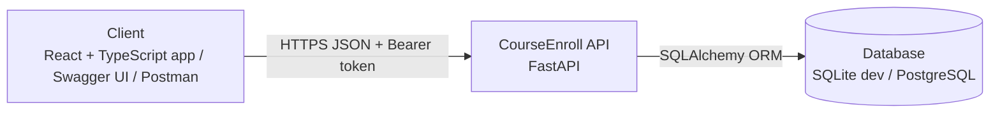
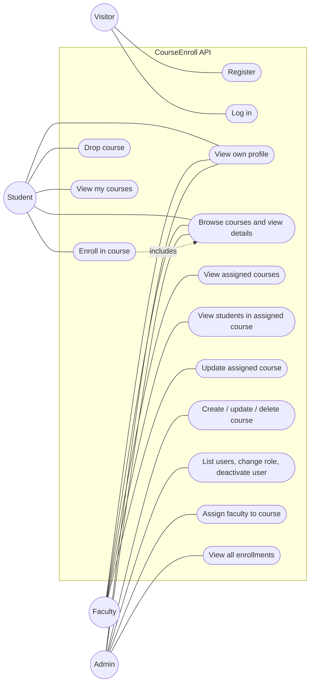
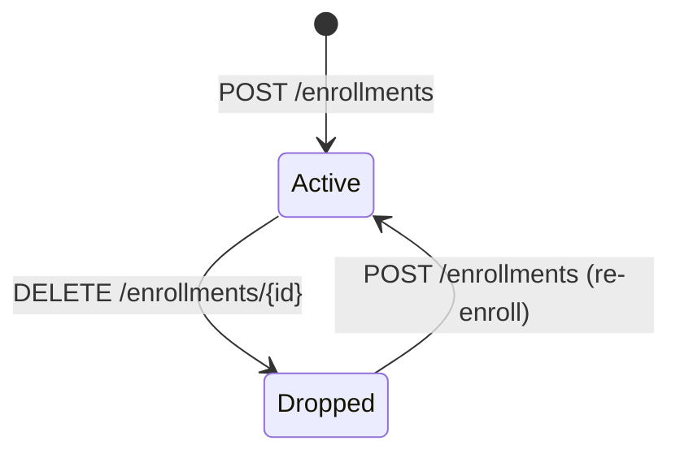

# Software Requirements Specification (SRS) — CourseEnroll

| Field | Value |
|---|---|
| Product | CourseEnroll – University Course Enrollment Management System |
| Document | Software Requirements Specification (SRS) |
| Version | 1.0 |
| Status | Draft |
| Date | 10 October 2026 |
| Author | Raihanur Akter — Student ID: 2310176 |
| Course / Section | Web Application & Internet (Course Code: 309), Section 06 |
| Submitted To | Sayef Reyadh, Lecturer |
| Task Issue Link | [Paste GitHub Issue URL here] |
| Pull Request Link | [Paste GitHub PR URL here] |
| Related docs | [Product Requirements Document (PRD)](PRD.md), [Technical Design Document (TDD)](TDD.md) |

**Documents in this set**

| Short form | Full form | Purpose | File |
|---|---|---|---|
| PRD | Product Requirements Document | What we build and why | [PRD.md](PRD.md) |
| SRS | Software Requirements Specification | Exact requirements, permissions and acceptance criteria (this document) | [SRS.md](SRS.md) |
| TDD | Technical Design Document | How we build it: architecture, data model, API | [TDD.md](TDD.md) |

## Table of Contents

1. [Introduction](#1-introduction)
2. [Overall description](#2-overall-description)
3. [Specific requirements](#3-specific-requirements)
4. [Non-functional requirements](#4-non-functional-requirements)
5. [Acceptance criteria](#5-acceptance-criteria)
6. [Traceability](#6-traceability)
7. [Appendices](#7-appendices)

---

## 1. Introduction

### 1.1 Purpose
This document lists the requirements for CourseEnroll: a secure, role-based web application where students enroll in courses, faculty manage their assigned courses and see their students, and administrators manage users, courses and faculty assignments. It is the reference for design, implementation and testing.

### 1.2 Scope
- **Students** register, log in, browse courses, enroll, drop and view their own enrollments.
- **Faculty** view their assigned courses, view the students enrolled in them and update their course details.
- **Admins** manage courses, users and roles, assign faculty to courses and view all enrollments.
- Every API endpoint is protected by authentication (JWT) and role-based authorization with permission scopes.
- Out of scope: see [PRD, section 7.2](PRD.md#72-out-of-scope-this-version) (payments, attendance/exams/GPA, AI/ML recommendation or chatbot, email/SMS notifications, timetable generation, live chat, mobile app, microservices).

### 1.3 Definitions

| Term | Meaning |
|---|---|
| CRUD | Create, Read, Update, Delete |
| REST | API style where resources (like `courses`) are accessed with HTTP methods (GET, POST, PUT, DELETE) |
| Course | An offered subject with a unique code, name, description, credit, capacity and an optional assigned faculty member |
| Enrollment | A link between one student and one course, with a status of `active` or `dropped` |
| Seats available | `capacity` minus the number of `active` enrollments of a course |
| RBAC | Role-Based Access Control: what a caller can do depends on their role |
| Scope | A named permission (for example `courses:create`) attached to a role and checked by the backend |
| JWT | JSON Web Token: a signed token that proves who the caller is |
| Access token | Short-lived JWT sent in the `Authorization: Bearer` header |
| ORM | Object-Relational Mapping (SQLAlchemy) |
| Client | Anything that calls the API: the React frontend, `/docs`, curl, Postman |
| OpenAPI | Standard API description; FastAPI generates it and shows it at `/docs` (Swagger UI) |
| FR / NFR / BR / SEC | Functional Requirement / Non-Functional Requirement / Business Rule / Security Requirement |

### 1.4 References
- CourseEnroll Project Proposal (8 October 2026)
- [PRD](PRD.md) and [TDD](TDD.md)
- IEEE Std 830-1998 / ISO/IEC/IEEE 29148 (SRS structure guidance)
- FastAPI, SQLAlchemy, Pydantic and React documentation

## 2. Overall description

### 2.1 System context

### 2.2 Users and roles

| Role | Description |
|---|---|
| Visitor | Not logged in; can only register and log in |
| Student | Primary user who enrolls in courses. Views courses, enrolls, drops own enrollment, views own enrollments |
| Faculty | Instructor responsible for assigned courses. Views assigned courses, updates their details, views students enrolled in them |
| Admin | System administrator. Manages users and roles, creates, updates and deletes courses, assigns faculty, views all enrollments |

`student`, `faculty` and `admin` are **global** roles stored on the user. A user has exactly one role. Public registration always creates a Student; only an Admin can change a role.

### 2.3 Use cases

Every Student, Faculty and Admin is also a logged-in user, so they can all view their own profile and browse courses.

| ID | Use case | Actor | FR |
|---|---|---|---|
| UC-1 | Register account | Visitor | FR-1 |
| UC-2 | Log in | All users | FR-2, FR-3, FR-4 |
| UC-3 | Browse courses and view details | Student | FR-5, FR-6 |
| UC-4 | Enroll in course | Student | FR-7 |
| UC-5 | Drop course | Student | FR-8 |
| UC-6 | View my courses | Student | FR-9 |
| UC-7 | View assigned courses and enrolled students | Faculty | FR-10, FR-11 |
| UC-8 | Update assigned course | Faculty | FR-12 |
| UC-9 | Manage courses | Admin | FR-13 |
| UC-10 | Manage users | Admin | FR-14 |
| UC-11 | Assign faculty to course | Admin | FR-15 |
| UC-12 | View all enrollments | Admin | FR-16 |

**UC-4 Enroll in course (detailed)**

| Item | Description |
|---|---|
| Actor | Student |
| Preconditions | Student is logged in and holds scope `enrollments:create` |
| Main flow | 1. Student opens a course's detail page. 2. Student clicks **Enroll**. 3. System verifies the token and scope. 4. System checks the course exists. 5. System checks the student has no active enrollment in it. 6. System checks seats are available. 7. System creates the enrollment with status `active`. 8. System returns `201`; the course appears under "My Courses". |
| Alternate flows | 4a. Course not found: `404`. 5a. Already enrolled: `409`. 6a. Course full: `409`. 7a. A dropped record exists: it is reactivated instead of creating a new row. |
| Postcondition | Seats available decrease by one |

**UC-5 Drop course (detailed)**

| Item | Description |
|---|---|
| Actor | Student |
| Preconditions | Student is logged in and holds scope `enrollments:delete_own` |
| Main flow | 1. Student opens "My Courses". 2. Student clicks **Drop**. 3. System verifies the enrollment belongs to the student. 4. System sets status to `dropped`. 5. System returns `200`. |
| Alternate flows | 3a. Enrollment not found: `404`. 3b. Belongs to another student: `403`. 3c. Already dropped: `409`. |
| Postcondition | The seat is freed |

**UC-11 Assign faculty to course (detailed)**

| Item | Description |
|---|---|
| Actor | Admin |
| Preconditions | Admin is logged in with scope `faculty:assign` |
| Main flow | 1. Admin opens `/admin/assignments`. 2. Admin selects a course and a faculty member. 3. System checks the user is an active Faculty. 4. System sets `courses.faculty_id`. 5. System returns the updated course. |
| Alternate flows | 3a. User is not Faculty or is inactive: `400`. 3b. Course or user not found: `404`. |

### 2.4 Constraints
- C-1: Frontend in React.js with TypeScript; backend in Python 3.11+ with FastAPI.
- C-2: All functionality is exposed through REST APIs; requests and responses use JSON.
- C-3: Authentication uses JWT; passwords are hashed with bcrypt.
- C-4: Exactly three roles; permissions are enforced on the backend.
- C-5: Database access only through the SQLAlchemy ORM; SQLite for development, PostgreSQL for deployment.
- C-6: Login is implemented in our own API (no third-party login providers).
- C-7: No AI/ML features; scope is limited to section 1.2.
- C-8: Client is any modern browser (latest two versions of Chrome, Firefox, Edge, Safari); server runs on any OS supporting Python 3.11+.

### 2.5 Assumptions
- A-1: Network connectivity exists between the client and the server.
- A-2: The first admin account is created by a seed script (`python -m app.seed`).
- A-3: Public registration creates only Students; an Admin promotes users to Faculty or Admin.
- A-4: A single academic term is assumed (no semester management).
- A-5: The app is used for demos and class work, so traffic is low (about 50 concurrent users at most).

## 3. Specific requirements

### 3.1 External interface requirements

**User interfaces**

| ID | Requirement |
|---|---|
| UI-1 | The UI shall be responsive and usable on desktop and tablet or mobile screen widths. |
| UI-2 | The UI shall provide a login page and a registration page for unauthenticated users. |
| UI-3 | After login, the user shall be redirected to the dashboard of their role (`/student/dashboard`, `/faculty/dashboard`, `/admin/dashboard`). |
| UI-4 | The UI shall show clear success and error messages (for example "Course is full", "Already enrolled"). |
| UI-5 | Pages belonging to another role shall not be accessible: protected routes redirect to login or a "Not authorized" page. |

| Role | Routes |
|---|---|
| Public | `/login`, `/register` |
| Student | `/student/dashboard`, `/student/courses`, `/student/courses/:id`, `/student/my-courses` |
| Faculty | `/faculty/dashboard`, `/faculty/courses`, `/faculty/courses/:id` |
| Admin | `/admin/dashboard`, `/admin/users`, `/admin/courses`, `/admin/assignments` |

**Software and communication interfaces**

| ID | Requirement |
|---|---|
| SI-1 | The frontend shall communicate with the backend only through the REST API using JSON over HTTP(S). |
| SI-2 | The frontend shall send `Authorization: Bearer <token>` with every protected request. |
| SI-3 | The backend shall access the database only through the SQLAlchemy ORM. |
| SI-4 | The backend shall publish OpenAPI documentation (Swagger UI at `/docs`). |
| SI-5 | CORS shall allow only the configured frontend origin. |

### 3.2 Functional requirements

Priority: **Must** or **Should**. The Story column links to the user stories in the [PRD](PRD.md#9-user-stories-and-acceptance-criteria).

#### 3.2.1 Authentication module

| ID | Requirement | Priority | Story |
|---|---|---|---|
| FR-1 | A new user shall be able to register with name, email and password. The email must be well-formed and unique (case-insensitive) and the password must have at least 8 characters. New users get the Student role. A duplicate email returns `409`. | Must | US-1 |
| FR-2 | A registered user shall be able to log in using email and password. Wrong email or password returns `401` with the same message for both; a deactivated account returns `403`. | Must | US-2 |
| FR-3 | The system shall issue a signed JWT access token on successful login, containing the user ID, role, permission scopes and an expiry time. | Must | US-2 |
| FR-4 | The system shall return the profile (`id`, `name`, `email`, `role`, `is_active`) of the logged-in user. The password hash is never returned. | Must | US-3 |

#### 3.2.2 Student module

| ID | Requirement | Priority | Story |
|---|---|---|---|
| FR-5 | A student shall be able to view all available courses, including code, name, credit, capacity and seats available. | Must | US-4 |
| FR-6 | A student shall be able to view the details of a course, including description and assigned faculty name. | Must | US-4 |
| FR-7 | A student shall be able to enroll in a course if seats are available and the student is not already actively enrolled in it. | Must | US-5 |
| FR-8 | A student shall be able to drop one of their own active enrollments. | Must | US-6 |
| FR-9 | A student shall be able to view the list of their own enrolled courses. | Must | US-7 |

#### 3.2.3 Faculty module

| ID | Requirement | Priority | Story |
|---|---|---|---|
| FR-10 | A faculty member shall be able to view the courses assigned to them. | Must | US-8 |
| FR-11 | A faculty member shall be able to view the students actively enrolled in a course assigned to them. | Must | US-9 |
| FR-12 | A faculty member shall be able to update the name, description and credit of a course assigned to them. | Should | US-10 |

#### 3.2.4 Admin module

| ID | Requirement | Priority | Story |
|---|---|---|---|
| FR-13 | An admin shall be able to create, update and delete courses. | Must | US-11 |
| FR-14 | An admin shall be able to view users, change user roles and deactivate users. | Must | US-12 |
| FR-15 | An admin shall be able to assign a faculty member to a course. | Must | US-13 |
| FR-16 | An admin shall be able to view all enrollments, optionally filtered by course or student. | Should | US-14 |

### 3.3 Business rules

| ID | Rule | Related FR | Error |
|---|---|---|---|
| BR-1 | Email addresses are unique across all users. | FR-1 | `409` |
| BR-2 | Public registration creates only Student accounts; roles are changed only by an Admin. | FR-1, FR-14 | — |
| BR-3 | A student cannot actively enroll in the same course twice (unique `(student_id, course_id)`). | FR-7 | `409` |
| BR-4 | A student cannot enroll in a course whose active enrollments already equal its capacity. | FR-7 | `409` |
| BR-5 | Seats available = `capacity − count(active enrollments)`. Dropped enrollments free a seat. | FR-5 – FR-8 | — |
| BR-6 | Dropping an enrollment sets its status to `dropped` (record kept). A student may re-enroll later, which reactivates the record. | FR-8 | — |
| BR-7 | A student can drop only their own enrollment. | FR-8 | `403` |
| BR-8 | A faculty member can view or update only courses where `faculty_id` equals their user ID. | FR-10 – FR-12 | `403` |
| BR-9 | Faculty cannot change `capacity`, `course_code` or `faculty_id`; these are Admin-only. | FR-12 | `403` |
| BR-10 | Course code is unique. Capacity and credit must be positive integers. | FR-13 | `409` / `400` |
| BR-11 | A course with active enrollments cannot be deleted. | FR-13 | `409` |
| BR-12 | Only an active user with the Faculty role can be assigned to a course. | FR-15 | `400` |
| BR-13 | Users are deactivated, not physically deleted (`is_active = false`). | FR-14 | — |
| BR-14 | An Admin cannot deactivate or change the role of their own account. | FR-14 | `400` |
| BR-15 | A Faculty user who still has assigned courses cannot be demoted or deactivated until the courses are reassigned. | FR-14 | `409` |
| BR-16 | A deactivated user's existing tokens are rejected on their next request. | FR-14 | `401` / `403` |
| BR-17 | Capacity cannot be reduced below the current number of active enrollments. | FR-13 | `409` |

### 3.4 REST API requirements

The system shall expose the following 18 endpoints. Each protected endpoint declares the scope it requires. Full request and response contracts are in [TDD, section 7](TDD.md#7-rest-api-design).

| # | Method | Endpoint | Description | Required access | Related FR |
|:-:|---|---|---|---|---|
| 1 | POST | `/auth/register` | Register a new user | Public | FR-1 |
| 2 | POST | `/auth/login` | Log in and receive token | Public | FR-2, FR-3 |
| 3 | GET | `/auth/me` | Current user profile | Authenticated | FR-4 |
| 4 | GET | `/courses` | List all courses | `courses:read` | FR-5 |
| 5 | GET | `/courses/{id}` | Course details | `courses:read` | FR-6 |
| 6 | POST | `/courses` | Create a course | `courses:create` (Admin) | FR-13 |
| 7 | PUT | `/courses/{id}` | Update a course | `courses:update` (Admin / assigned Faculty) | FR-12, FR-13 |
| 8 | DELETE | `/courses/{id}` | Delete a course | `courses:delete` (Admin) | FR-13 |
| 9 | PUT | `/courses/{id}/faculty` | Assign faculty to course | `faculty:assign` (Admin) | FR-15 |
| 10 | POST | `/enrollments` | Enroll in a course | `enrollments:create` (Student) | FR-7 |
| 11 | GET | `/enrollments/my` | List own enrollments | `enrollments:read_own` (Student) | FR-9 |
| 12 | DELETE | `/enrollments/{id}` | Drop an enrollment | `enrollments:delete_own` (Student) | FR-8 |
| 13 | GET | `/enrollments` | List all enrollments | `enrollments:read_all` (Admin) | FR-16 |
| 14 | GET | `/faculty/courses` | List assigned courses | Faculty role | FR-10 |
| 15 | GET | `/faculty/courses/{id}/students` | Students in assigned course | `enrollments:read_assigned` (Faculty) | FR-11 |
| 16 | GET | `/users` | List users (optional `role` filter) | `users:read` (Admin) | FR-14 |
| 17 | PUT | `/users/{id}` | Update role / status | `users:manage` (Admin) | FR-14 |
| 18 | DELETE | `/users/{id}` | Deactivate user | `users:manage` (Admin) | FR-14 |

### 3.5 Security, authentication and authorization requirements

| ID | Requirement |
|---|---|
| SEC-1 | Passwords shall be stored only as salted bcrypt hashes; plain passwords are never stored, logged or returned. |
| SEC-2 | All endpoints except `/auth/register` and `/auth/login` shall require a valid, unexpired JWT. |
| SEC-3 | The JWT shall be signed (HS256) with a secret loaded from environment configuration, never hard-coded. |
| SEC-4 | Access tokens shall expire after a limited period (default 60 minutes). |
| SEC-5 | Each protected endpoint shall verify that the caller's role holds the required permission scope before executing. |
| SEC-6 | The backend shall enforce ownership checks (own enrollment, assigned course) in addition to scope checks. |
| SEC-7 | The backend shall re-load the user on every request and reject deactivated users. |
| SEC-8 | All input shall be validated with Pydantic schemas; invalid input shall not reach the database layer. |
| SEC-9 | Database access shall use the ORM (parameterized queries) to prevent SQL injection. |
| SEC-10 | CORS shall be restricted to the configured frontend origin. |
| SEC-11 | Error responses shall not reveal sensitive details (stack traces, hashes, or whether an email exists on login failure). |
| SEC-12 | The frontend shall protect routes by authentication and role; the backend remains the final authority. |

**Role to scope mapping** (embedded in the token at login)

| Role | Scopes |
|---|---|
| Student | `courses:read`, `enrollments:create`, `enrollments:read_own`, `enrollments:delete_own` |
| Faculty | `courses:read`, `courses:update` (assigned only), `enrollments:read_assigned` |
| Admin | `courses:read`, `courses:create`, `courses:update`, `courses:delete`, `enrollments:read_all`, `users:read`, `users:manage`, `faculty:assign` |

### 3.6 Data requirements and validation rules

**users**

| Field | Type | Constraints |
|---|---|---|
| id | Integer | PK |
| name | String | Not null |
| email | String | Unique, not null |
| password_hash | String | Not null |
| role | Enum(student, faculty, admin) | Not null, default `student` |
| is_active | Boolean | Not null, default true |

**courses**

| Field | Type | Constraints |
|---|---|---|
| id | Integer | PK |
| course_code | String | Unique, not null (for example CSE303) |
| course_name | String | Not null |
| description | Text | Optional |
| credit | Integer | > 0 |
| capacity | Integer | > 0 |
| faculty_id | Integer | FK to users.id, nullable (faculty) |

**enrollments**

| Field | Type | Constraints |
|---|---|---|
| id | Integer | PK |
| student_id | Integer | FK to users.id |
| course_id | Integer | FK to courses.id |
| enrolled_at | DateTime | Default current time |
| status | Enum(active, dropped) | Default `active` |

Relationships: one faculty has many courses (1:N); students and courses are many-to-many through `enrollments`; unique constraint on `(student_id, course_id)`.

**Validation rules**

| Field | Rule |
|---|---|
| `name` | Required, 2–100 characters |
| `email` | Valid email, stored lowercase |
| `password` | Minimum 8 characters |
| `course_code` | Required on create, 3–20 characters, alphanumeric, stored uppercase, unique |
| `course_name` | Required on create, 1–150 characters |
| `description` | Optional text |
| `credit` | Integer from 1 to 6 |
| `capacity` | Integer from 1 to 500 |
| `role` | One of `student`, `faculty`, `admin` |
| `course_id` (enroll) | Integer, must reference an existing course |
| `faculty_id` (assign) | Integer, must reference an active user with role `faculty` |

### 3.7 Enrollment states

A new enrollment always starts as `Active`. Dropping keeps the record with status `Dropped`; enrolling again in the same course reactivates it. Only `Active` enrollments count toward capacity and appear in "My Courses" and faculty student lists.

### 3.8 Permission matrix (by action)

| Action | Visitor | Student | Faculty | Admin |
|---|---|---|---|---|
| Register, log in | Yes | — | — | — |
| View own profile (`/auth/me`) | No | Yes | Yes | Yes |
| List courses, view course details | No | Yes | Yes | Yes |
| Enroll in a course | No | Yes | No (`403`) | No (`403`) |
| View own enrollments | No | Yes | No (`403`) | No (`403`) |
| Drop an enrollment | No | Own only (other's: `403`) | No (`403`) | No (`403`) |
| View assigned courses | No | No (`403`) | Yes | No (`403`) |
| View students of a course | No | No (`403`) | Assigned courses only (others: `403`) | No (`403`) |
| Update a course | No | No (`403`) | Assigned only, name / description / credit | Yes, all fields |
| Create or delete a course | No | No (`403`) | No (`403`) | Yes |
| Assign faculty to a course | No | No (`403`) | No (`403`) | Yes |
| View all enrollments | No | No (`403`) | No (`403`) | Yes |
| List users, change role, deactivate | No | No (`403`) | No (`403`) | Yes (not own account) |

"No" for a Visitor always means `401` because there is no valid token.

### 3.9 Permission matrix (by endpoint)

| Endpoint | Visitor | Student | Faculty | Admin |
|---|:-:|:-:|:-:|:-:|
| POST `/auth/register`, `/auth/login` | ✔ | ✔ | ✔ | ✔ |
| GET `/auth/me` | ✘ 401 | ✔ | ✔ | ✔ |
| GET `/courses`, `/courses/{id}` | ✘ 401 | ✔ | ✔ | ✔ |
| POST `/courses` | ✘ 401 | ✘ 403 | ✘ 403 | ✔ |
| PUT `/courses/{id}` | ✘ 401 | ✘ 403 | ✔ assigned only | ✔ |
| DELETE `/courses/{id}` | ✘ 401 | ✘ 403 | ✘ 403 | ✔ |
| PUT `/courses/{id}/faculty` | ✘ 401 | ✘ 403 | ✘ 403 | ✔ |
| POST `/enrollments` | ✘ 401 | ✔ | ✘ 403 | ✘ 403 |
| GET `/enrollments/my` | ✘ 401 | ✔ | ✘ 403 | ✘ 403 |
| DELETE `/enrollments/{id}` | ✘ 401 | ✔ own only | ✘ 403 | ✘ 403 |
| GET `/enrollments` | ✘ 401 | ✘ 403 | ✘ 403 | ✔ |
| GET `/faculty/courses` | ✘ 401 | ✘ 403 | ✔ | ✘ 403 |
| GET `/faculty/courses/{id}/students` | ✘ 401 | ✘ 403 | ✔ assigned only | ✘ 403 |
| GET `/users` | ✘ 401 | ✘ 403 | ✘ 403 | ✔ |
| PUT / DELETE `/users/{id}` | ✘ 401 | ✘ 403 | ✘ 403 | ✔ |

This matrix is the basis of the automated RBAC sweep test in [TDD, section 12.3](TDD.md#123-rbac-sweep-cross-cutting).

### 3.10 Permission scopes

| Permission scope | Student | Faculty | Admin |
|---|:-:|:-:|:-:|
| `courses:read` | Yes | Yes | Yes |
| `courses:create` | No | No | Yes |
| `courses:update` | No | Assigned only | Yes |
| `courses:delete` | No | No | Yes |
| `enrollments:create` | Yes | No | No |
| `enrollments:read_own` | Yes | No | No |
| `enrollments:delete_own` | Yes | No | No |
| `enrollments:read_assigned` | No | Yes | No |
| `enrollments:read_all` | No | No | Yes |
| `users:read` | No | No | Yes |
| `users:manage` | No | No | Yes |
| `faculty:assign` | No | No | Yes |

### 3.11 Status codes

| Case | Code |
|---|---|
| Read or update succeeded | `200 OK` |
| Resource created (register, course, enrollment) | `201 Created` |
| Deleted (course) | `204 No Content` |
| Bad request or invalid input (including validation errors) | `400 Bad Request` |
| Missing, invalid or expired token; wrong login | `401 Unauthorized` |
| Logged in but role or ownership not allowed; deactivated account on login | `403 Forbidden` |
| Resource not found | `404 Not Found` |
| Duplicate, course full, delete blocked | `409 Conflict` |
| Unexpected server error | `500 Internal Server Error` |

Error body format: `{ "detail": "Course is full" }`. Validation errors (`422` from FastAPI/Pydantic) are normalized to `400` with a list of field messages.

## 4. Non-functional requirements

| ID | Category | Requirement |
|---|---|---|
| NFR-1 | Performance | 95% of API requests answer in under 2 seconds under normal load (up to about 50 concurrent users). |
| NFR-2 | Security | All requirements in section 3.5 (SEC-1 to SEC-12) are met. |
| NFR-3 | Security | Every permission check runs on the server for every request; the frontend hiding a button is never the only protection. |
| NFR-4 | Usability | Consistent layout and navigation; each role has its own dashboard; every action gives clear feedback. |
| NFR-5 | Reliability | Validation and meaningful error responses prevent invalid data; the enrollment capacity check and insert are atomic (one transaction). |
| NFR-6 | Persistence | Data is stored in a database and is not lost on restart. |
| NFR-7 | Maintainability | Backend is split into routers, schemas, services, models and dependencies; frontend into components, pages, layouts, services, hooks, types and context. |
| NFR-8 | Portability | Runs on any modern browser; backend runs on any OS supporting Python 3.11+. |
| NFR-9 | Compatibility | Supports the latest two versions of Chrome, Firefox, Edge and Safari. |
| NFR-10 | Documentation | Every endpoint is listed in `/docs` with request and response schemas; PRD, SRS and TDD stay consistent with the implementation. |
| NFR-11 | Testability | Core services have Pytest unit tests; every endpoint is tested for allowed and forbidden roles. |
| NFR-12 | Security | Responses do not expose stack traces or database details. |

## 5. Acceptance criteria

Each criterion is written as Given / When / Then and can be checked in Swagger UI, Postman or Pytest.

### Authentication

**AC-01 Register (FR-1, BR-1, BR-2)**
- Given no account exists for `rafi@uni.edu`
- When a visitor sends `POST /auth/register` with a valid name, that email and a password of at least 8 characters
- Then the response is `201` with role `student` and no password field.
- When anyone registers again with `RAFI@uni.edu`, the response is `409`.
- When the password has fewer than 8 characters or the email is malformed, the response is `400`.

**AC-02 Log in (FR-2, FR-3)**
- Given user `rafi@uni.edu` exists and is active
- When they send `POST /auth/login` with the right password, the response is `200` with an `access_token`.
- When they send a wrong password, or an unknown email, the response is `401` with the same message.
- When their account is deactivated, the response is `403`.

**AC-03 Token content (FR-3)**
- Given a successful login
- When the access token is decoded
- Then it contains `sub` (user ID), `role`, `scopes` and `exp`, and the scopes match the role in section 3.5.

**AC-04 Current profile (FR-4)**
- Given a valid access token
- When the client sends `GET /auth/me`
- Then the response is `200` with `id`, `name`, `email`, `role`, `is_active` and no password hash.
- When the token is missing or expired, the response is `401`.

**AC-05 Token required (SEC-2)**
- When a client calls any endpoint other than `/auth/register` and `/auth/login` without a token, or with an expired or tampered one
- Then the response is `401`.

### Student

**AC-06 List courses (FR-5, BR-5)**
- Given 3 courses exist and one has 31 active enrollments out of capacity 40
- When a student sends `GET /courses`
- Then the response is `200` with all 3 courses, each with code, name, credit, capacity and `seats_available` (9 for that course).

**AC-07 Course details (FR-6)**
- Given course `3` exists with an assigned faculty member
- When a student sends `GET /courses/3`, the response is `200` with description and faculty name.
- When a student sends `GET /courses/9999`, the response is `404`.

**AC-08 Enroll (FR-7, BR-5)**
- Given course `3` has free seats and the student is not enrolled in it
- When the student sends `POST /enrollments` with `{"course_id": 3}`
- Then the response is `201`, the enrollment status is `active`, and the course's seats available drop by one.
- When `course_id` does not exist, the response is `404`.

**AC-09 Duplicate enrollment (FR-7, BR-3)**
- Given the student already has an active enrollment in course `3`
- When they send `POST /enrollments` for course `3` again
- Then the response is `409` and no new row is created.

**AC-10 Full course (FR-7, BR-4)**
- Given course `4` has capacity 30 and 30 active enrollments
- When a student sends `POST /enrollments` for course `4`
- Then the response is `409` with the message "Course is full".

**AC-11 Re-enroll after drop (FR-7, BR-6)**
- Given the student dropped course `3` earlier
- When they send `POST /enrollments` for course `3` and a seat is free
- Then the response is `201`, the existing record is reactivated (status `active`), and no duplicate row exists.

**AC-12 Drop own enrollment (FR-8, BR-5, BR-6)**
- Given the student has an active enrollment `11`
- When they send `DELETE /enrollments/11`
- Then the response is `200`, the status is `dropped`, and the course's seats available rise by one.

**AC-13 Drop not allowed (FR-8, BR-7)**
- Given enrollment `12` belongs to another student
- When a student sends `DELETE /enrollments/12`, the response is `403` and the enrollment is unchanged.
- When enrollment `11` is already dropped, the response is `409`.
- When the enrollment does not exist, the response is `404`.

**AC-14 My courses (FR-9)**
- Given the student has 2 active and 1 dropped enrollment, and other students have enrollments too
- When the student sends `GET /enrollments/my`
- Then the response is `200` with only the student's 2 active enrollments.

### Faculty

**AC-15 Assigned courses (FR-10, BR-8)**
- Given faculty A is assigned to 2 courses and faculty B to 1 other course
- When faculty A sends `GET /faculty/courses`
- Then the response is `200` with exactly A's 2 courses.
- When a student or admin calls it, the response is `403`.

**AC-16 Students in assigned course (FR-11, BR-8)**
- Given course `3` is assigned to faculty A and has 5 active and 2 dropped enrollments
- When faculty A sends `GET /faculty/courses/3/students`, the response is `200` with the 5 active students (name, email, enrolled date).
- When faculty B sends the same request, the response is `403`.

**AC-17 Update assigned course (FR-12, BR-8, BR-9)**
- Given course `3` is assigned to faculty A
- When A sends `PUT /courses/3` with a new `description`, the response is `200` and the description is updated.
- When A tries to change `capacity`, `course_code` or `faculty_id`, the response is `403`.
- When faculty B updates course `3`, the response is `403`.

### Admin

**AC-18 Create course (FR-13, BR-10)**
- When an admin sends `POST /courses` with `course_code`, `course_name`, `credit` and `capacity`
- Then the response is `201` with the new course.
- When the course code already exists, the response is `409`.
- When `capacity` or `credit` is 0 or negative, the response is `400`.
- When a student or faculty sends it, the response is `403`.

**AC-19 Update and delete course (FR-13, BR-11, BR-17)**
- When an admin sends `PUT /courses/3` with a new name, the response is `200`.
- When capacity is set below the current number of active enrollments, the response is `409`.
- Given course `3` has active enrollments, `DELETE /courses/3` returns `409`.
- Given course `5` has no active enrollments, `DELETE /courses/5` returns `204` and a later `GET /courses/5` returns `404`.

**AC-20 List users and change role (FR-14, BR-2)**
- When an admin sends `GET /users?role=faculty`, the response is `200` with only faculty users.
- When an admin sends `PUT /users/7` with `{"role": "faculty"}`, the response is `200` and user 7's next request is authorized as Faculty.
- When a student sends `GET /users`, the response is `403`.

**AC-21 Deactivate user (FR-14, BR-13, BR-16)**
- Given user `7` is logged in with a valid access token
- When an admin sends `DELETE /users/7`
- Then the response is `200` with `is_active: false`, user 7's next request with the same token returns `401` or `403`, and user 7's login returns `403`.
- The user's enrollment history is kept.

**AC-22 Admin protections (BR-14, BR-15)**
- When an admin tries to deactivate or change the role of their own account, the response is `400`.
- Given faculty user `2` still has assigned courses
- When an admin deactivates or demotes user 2, the response is `409`.

**AC-23 Assign faculty (FR-15, BR-12)**
- When an admin sends `PUT /courses/3/faculty` with `{"faculty_id": 2}` and user 2 is an active faculty member
- Then the response is `200` and the course shows that faculty.
- When `faculty_id` is a student or an inactive user, the response is `400`.
- When the course or user does not exist, the response is `404`.

**AC-24 All enrollments (FR-16)**
- Given enrollments exist for several courses and students
- When an admin sends `GET /enrollments?course_id=3`
- Then the response is `200` with only the enrollments of course 3.
- When a student or faculty sends it, the response is `403`.

### Security and interface

**AC-25 Role enforcement across endpoints (SEC-5, NFR-3)**
- Given a valid token for each role
- When every endpoint is called with every role as described in section 3.9
- Then anonymous callers get `401`, forbidden roles get `403`, and permitted roles succeed.

**AC-26 Password storage (SEC-1)**
- Given a registered user
- When the `users` table is inspected
- Then `password_hash` is a bcrypt hash that differs from the password, and no API response contains it.

**AC-27 Frontend route protection (UI-3, UI-5, SEC-12)**
- Given a logged-out visitor, when they open `/student/my-courses`, they are redirected to `/login`.
- Given a logged-in student, when they open `/admin/users`, they are redirected to "Not authorized".
- After login, each user lands on the dashboard of their own role.

**AC-28 Seat feedback in the UI (UI-4, FR-7)**
- Given a course with 0 seats available
- When a student views it
- Then the Enroll button is disabled, and a failed enrollment shows the backend message (for example "Course is full").

## 6. Traceability

| Story | Requirements | Endpoint (see [TDD, section 7](TDD.md#7-rest-api-design)) | Acceptance criteria | Test cases ([TDD, section 12](TDD.md#12-testing-plan)) |
|---|---|---|---|---|
| US-1 | FR-1, BR-1, BR-2 | `POST /auth/register` | AC-01, AC-26 | TC-01, TC-02 |
| US-2 | FR-2, FR-3, BR-16 | `POST /auth/login` | AC-02, AC-03 | TC-03 – TC-06 |
| US-3 | FR-4 | `GET /auth/me` | AC-04, AC-05 | TC-07, TC-08 |
| US-4 | FR-5, FR-6, BR-5 | `GET /courses`, `GET /courses/{id}` | AC-06, AC-07 | TC-09 – TC-11 |
| US-5 | FR-7, BR-3, BR-4, BR-5, BR-6 | `POST /enrollments` | AC-08 – AC-11, AC-28 | TC-12 – TC-15 |
| US-6 | FR-8, BR-6, BR-7 | `DELETE /enrollments/{id}` | AC-12, AC-13 | TC-16 – TC-18 |
| US-7 | FR-9 | `GET /enrollments/my` | AC-14 | TC-19 |
| US-8 | FR-10, BR-8 | `GET /faculty/courses` | AC-15 | TC-20 |
| US-9 | FR-11, BR-8 | `GET /faculty/courses/{id}/students` | AC-16 | TC-21, TC-22 |
| US-10 | FR-12, BR-8, BR-9 | `PUT /courses/{id}` | AC-17 | TC-23, TC-24 |
| US-11 | FR-13, BR-10, BR-11, BR-17 | `POST` / `PUT` / `DELETE /courses` | AC-18, AC-19 | TC-25 – TC-28 |
| US-12 | FR-14, BR-2, BR-13 – BR-16 | `GET` / `PUT` / `DELETE /users` | AC-20 – AC-22 | TC-29 – TC-32 |
| US-13 | FR-15, BR-12 | `PUT /courses/{id}/faculty` | AC-23 | TC-33, TC-34 |
| US-14 | FR-16 | `GET /enrollments` | AC-24 | TC-35 |
| All | SEC-1 – SEC-12, NFR-3, UI-3, UI-5 | All endpoints, all routes | AC-05, AC-25 – AC-27 | RBAC sweep (TDD 12.3) |

## 7. Appendices

### Appendix A — Design decisions recorded as assumptions

| # | Decision | Reason |
|---|---|---|
| 1 | Public registration creates a Student only. | Prevents self-assigned privileged roles. |
| 2 | Users are deactivated rather than deleted. | Preserves enrollment history. |
| 3 | Faculty may edit only name, description and credit. | Capacity and assignment affect enrollment integrity. |
| 4 | Logout is client-side (token discarded). | JWT is stateless; there is no token blacklist in this version. |
| 5 | Drop is a soft status change. | Keeps a history of enrollments and works with the unique `(student_id, course_id)` constraint. |